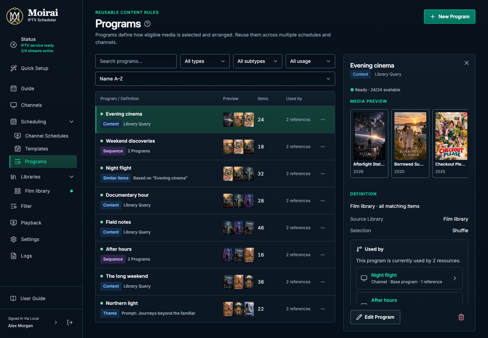

# Moirai design language

A source-backed reference for the current Moirai UI, with shared styling unified where the application is inconsistent. Existing page layouts, resource ownership, controls and navigation are the starting point. The application now implements the reviewed rules; see [application adoption](docs/application-adoption.md) for runtime ownership, coverage and production token ownership.

The [current UI mapping](docs/current-ui.md) identifies the source owners for every component family, distinguishes observed behavior from reviewed style unifications, and links stored application captures. Substantial layout or interaction changes require separate proposals. The reviewed smaller corner scale is now permanent.

**Start here:** [Audit and preserved decisions](docs/audit.md) → [Current UI mapping](docs/current-ui.md) → [Foundations](components/foundations.md) → [Shared behavior](docs/behavior.md) → [Motion](docs/motion.md) → [Component specifications](#component-specifications) → [Layout recipes](docs/layouts.md).



## Corner scale

The application, gallery, tokens and component specifications use the permanent smaller scale: small **2px**, controls **4px**, panels **6px**, and dialogs **8px**. Circular artwork, status dots and fully rounded switch tracks remain round. [Historical comparison images](experiments/radius-50/README.md) document the completed trial.

## Open the reference

From the repository root:

```bash
node docs/design-language/scripts/serve.mjs
```

Open [the local gallery](http://127.0.0.1:4179). It contains component boards, working interaction examples, full page compositions and exploratory concepts. Source entry: [index.html](index.html). ES modules require the local server; opening the HTML as a `file:` URL is not supported.

The current source mapping and documented shared-style decisions define the reference. Rendered PNGs demonstrate it. [AI-generated concepts](concepts/README.md) explore mood and composition; their invented details do not override the measured reference. All content is fictional, locally available and offline after checkout and dependency installation. No application server, database, API or font CDN is used.

This directory is tracked reference material, outside application and user-guide builds. It is excluded from the Docker build context. Preview and screenshot commands run only when explicitly invoked.

## Component specifications

Each family includes anatomy, exact dimensions, token roles, variants, applicable states, behavior, keyboard/focus guidance, responsive rules, edge cases, a specimen PNG and a linked full composition. The [shared state contract](docs/behavior.md) applies to every family.

| Family | Specification | Rendered example |
| --- | --- | --- |
| Foundations | [Color, typography, space, shape, icons, depth](components/foundations.md) | [Board](images/specimens/foundations.png) |
| Navigation & structure | [Shell, headers, tabs, panels, disclosures](components/navigation.md) | [Board](images/specimens/navigation.png) |
| Actions | [Buttons, links, icon actions, state matrix](components/actions.md) | [Board](images/specimens/actions.png) |
| Text & selection fields | [Text, numeric, textarea, select, combobox, validation](components/fields.md) | [Board](images/specimens/fields.png) |
| Choice controls | [Checkbox, radio, switch, slider, segmented choice](components/choices.md) | [Board](images/specimens/choices.png) |
| Search & filtering | [Search, facets, filter chips, sorting, bulk scope](components/search.md) | [Board](images/specimens/search.png) |
| Collections | [Tables, rows, selection, pagination](components/collections.md) | [Board](images/specimens/collections.png) |
| Media & artwork | [Cards, images, fallback and preview treatment](components/media.md) | [Board](images/specimens/media.png) |
| Metadata & inspectors | [Badges, status, properties, selected context](components/metadata.md) | [Board](images/specimens/metadata.png) |
| Feedback & async states | [Loading, empty, failed, populated, progress, banners, toasts](components/feedback.md) | [Board](images/specimens/feedback.png) |
| Overlays & contextual help | [Menus, tooltips, popovers, dialogs, drawers, confirmation](components/overlays.md) | [Board](images/specimens/overlays.png) |
| Resource editors | [Protected drafts, grouped fields, persistent actions](components/editor.md) | [Board](images/specimens/editor.png) |
| Guide & scheduling | [Timeline, program blocks, layers, precedence](components/scheduling.md) | [Board](images/specimens/scheduling.png) |
| Program composition | [Sources, sequences, media review, playback preferences](components/programs.md) | [Board](images/specimens/programs.png) |
| Playback & operations | [Now playing, readiness, capacity, logs](components/operations.md) | [Board](images/specimens/operations.png) |

## Complete compositions

| Recipe | Image |
| --- | --- |
| Current Program overview list and inspector | [1440×1000](images/layouts/catalog.png) |
| Media library with artwork and selection | [1440×1000](images/layouts/library.png), [expanded](images/layouts/library-expanded.png), [390px](images/layouts/library-390.png), [320px](images/layouts/library-320.png) |
| Status / active playback, index health and data conflicts | [1440×1000](images/layouts/status.png) |
| Logs / structured entries and retained files | [1440×1000](images/layouts/logs.png) |
| Committed Guide, compact feed-copy bar and artwork timeline | [1440×1000](images/layouts/guide.png), [390px](images/layouts/guide-390.png), [320px](images/layouts/guide-320.png) |
| Sequence Program editor with counted steps and ordering | [1440×1000](images/layouts/program-editor.png), [390px](images/layouts/program-editor-390.png), [320px](images/layouts/program-editor-320.png) |
| Channel-owned base and conditional schedule stacks | [1440×1000](images/layouts/schedules.png) |
| Resource editor | [1440×1000](images/layouts/editor.png), [scrolled](images/layouts/editor-scrolled.png) |
| Settings and validation | [1440×1000](images/layouts/settings.png) |
| Mobile catalog | [390×844](images/layouts/mobile-catalog.png), [expanded](images/layouts/mobile-catalog-expanded.png) |
| Mobile resource editor | [390×844](images/layouts/mobile-editor.png), [scrolled](images/layouts/mobile-editor-scrolled.png) |

See [layout recipes and the new-screen checklist](docs/layouts.md) for composition decisions.

## Maintain and validate

- [Current source mapping and stored application captures](docs/current-ui.md).
- [Exact token index](docs/tokens.md) and [source stylesheet](tokens.css).
- [Iteration, capture and verification commands](docs/iteration.md).
- [Validation evidence and limits](docs/validation.md).
- [Local font and icon provenance / licenses](assets/README.md).
- [Exploratory concepts and exact generation prompts](concepts/README.md).
- [Capture environment and screenshot hashes](images/captures.json).

The guide preserves the current app’s composition and makes its shared-style exceptions explicit. Subtle gradients across surfaces and actions, consistent control sizing, stronger essential boundaries, plain icons and connected view selectors remain reviewed unifications. The smaller corner scale is permanent; source-owned layouts remain the baseline.

## Reference influences

The organization draws on Apple's [Human Interface Guidelines](https://developer.apple.com/design/human-interface-guidelines/) and Material's [foundations](https://m3.material.io/foundations/) approach to tokens, components and interaction states. Their platform styles are not imported wholesale. Moirai retains its existing identity, repository interaction contracts and Vue architecture. Existing Playwright and native web controls provide the small reference harness; no component framework dependency was added.

Library references: [normal browsing](images/layouts/library.png) · [bulk selection](images/layouts/library-bulk.png). Both card modes are preserved in the working gallery.

[Current-UI audit and preserved decisions](docs/audit.md) records the source comparison and explicit user revisions.
