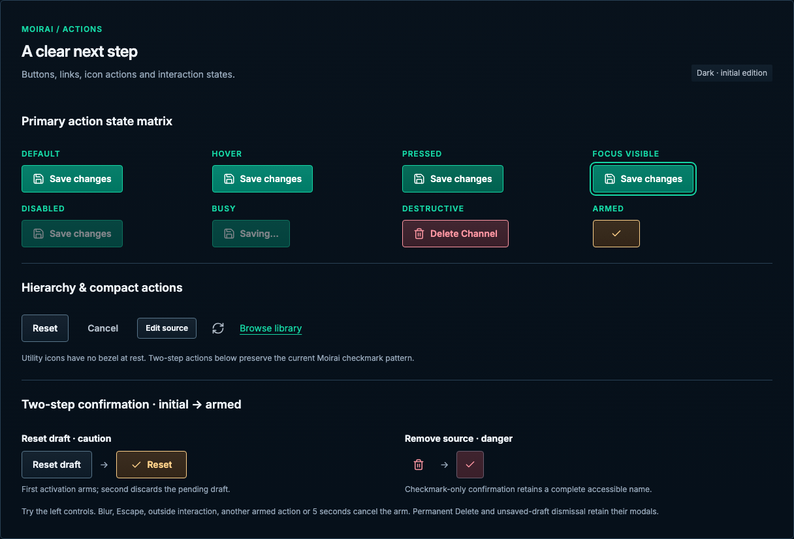

# Actions

[Handbook](../README.md) · [Live specimen](../index.html?family=actions) · [Full layout](../images/layouts/editor.png)

## Current UI baseline

Use existing primary, secondary, contextual and icon action roles. Reset and draft-local removal use TwoStepActionButton; permanent deletion and protected draft dismissal remain separate modal decisions. A pristine resource editor shows Close in its save-action position.

Source owners: [TwoStepActionButton.vue](../../../apps/web/src/components/TwoStepActionButton.vue), [ResourceEditorActionBar.vue](../../../apps/web/src/components/ResourceEditorActionBar.vue).

Apply [the current-UI mapping and reviewed unifications](../docs/current-ui.md) before the component parameters below. Radii use the permanent 2 / 4 / 6 / 8px scale for small / control / panel / dialog corners.

## Purpose and anatomy

Make the next intentional step obvious. A button combines a verb, leading icon for prominent primary/destructive actions, target area, boundary and state feedback. Keep one primary action per immediate task. A link changes location or opens a referenced resource; it must not masquerade as destructive mutation.

## Parameters and variants

| Variant     | Parameters                                                                             | Use                                                                                  |
| ----------- | -------------------------------------------------------------------------------------- | ------------------------------------------------------------------------------------ |
| Primary     | 42px minimum, 16px horizontal / 8px vertical padding, 8px gap, 4px radius, 14/20px 600 | Green `--color-primary` fill, mint border; white `--color-on-primary` text and icons |
| Secondary   | Same geometry, raised fill, control border, primary text                               | Reset, Edit, other supporting actions                                                |
| Ghost       | Same target, transparent boundary, secondary text                                      | Cancel or a clearly contextual action                                                |
| Destructive | Same geometry, danger surface/text/border                                              | Delete persisted resource; opens a modal                                             |
| Compact     | 32px minimum, 12px horizontal / 4px vertical, 12/18px 600                              | Dense desktop row action; never phone-only target                                    |
| Icon-only   | 42×42px desktop; 20px icon                                                             | Bezel-free for utilities such as refresh; accessible name required                   |
| Link        | 14/22px, mint, visible underline                                                       | Navigation embedded in prose                                                         |

## Icons for prominent actions

Pair the visible verb with a leading Lucide icon for prominent primary or destructive actions,
such as Save, New Program, Review Selection, Create backup and Delete. Use 18×18px glyphs, a 2px stroke
and the existing 8px button gap. The glyph inherits the label color, including white-on-green,
destructive and disabled states; it has no separate bezel. Keep the visible text label.

Detailed selection cards are a distinct control family; their icons explain the options rather than promoting an action. See [significant choices](choices.md#detailed-choices-for-significant-decisions).

Secondary and subdued actions stay text-only, including Cancel, Close, Reset, supporting Edit,
media-picking and import controls. Importance comes from the action’s role and emphasis, not simply
having a recognizable icon. Tabs, pagination and incidental links also remain text-only.

| Prominent intent | Icon     |
| ---------------- | -------- |
| Save             | Save     |
| New / add        | Plus     |
| Delete           | Trash2   |
| Create backup    | Download |

Two-step confirmation still replaces the original label with the established checkmark treatment;
cancellation restores the original text-only supporting action. Busy Save keeps its familiar Save
glyph and explicit busy state. These are reference standards for future adoption, not changes to
the production application.

## Subtle surface gradient

Filled primary, secondary, destructive and armed actions use `--button-surface-gradient` over their
semantic state fill: white at 3% on top to black at 4% below, vertically. Keep the same restrained
overlay on hover and pressed fills. There is no drop shadow, inset bevel, text shadow or movement.
Ghost actions, utility icons, tabs and menu rows retain their transparent surfaces. Segmented
choices use the quieter shared surface gradient.
The permanent corner scale applies to every action state.

## State matrix

| State    | Appearance and semantics                                                                                                        |
| -------- | ------------------------------------------------------------------------------------------------------------------------------- |
| Default  | Variant styling above                                                                                                           |
| Hover    | Raised actions use hover surface; primary uses `--color-primary-hover`                                                          |
| Pressed  | Primary uses `--color-primary-pressed`; other actions use selected surface                                                      |
| Focus    | Global 2px mint outline and 3px offset; never replace with hover                                                                |
| Selected | Use toggle buttons with `aria-pressed`; selection is not a generic action state                                                 |
| Disabled | Native disabled; 0.48 opacity, no click, not-allowed cursor; explain non-obvious prerequisites nearby                           |
| Busy     | Stable label width, explicit “Saving…” and `aria-busy`; block conflicting work                                                  |
| Armed    | Caution or danger tone, 17px checkmark, optional text, confirmation accessible name and `aria-pressed="true"`; 5-second timeout |

## Behavior and accessibility

Native buttons support Enter and Space. Give non-submit buttons `type="button"` inside forms. Icons are decorative when accompanied by a label. Icon-only accessible names include context, such as “Actions for Evening cinema.” Do not hide a primary action behind an icon-only control.

Two-step draft-local actions match the existing `TwoStepActionButton`. First activation replaces the initial content with a 17px checkmark and optional short confirmation text; it changes the accessible name and sets `aria-pressed="true"`. Second activation performs the action. Keep the unarmed button’s exact width, height, corner shape and layout position while armed; adjacent controls must not move. Preserve the initial content invisibly in flow and center the confirmation over it. Show optional confirmation text only when it fits the existing content area; otherwise show the checkmark alone while retaining the full confirmation accessible name. Do not enlarge, shrink or translate the button to fit the armed content. Use caution styling for Reset and danger styling for removal. Cancel on blur, Escape, outside interaction, another armed action or the five-second timeout; cancellation restores the initial content and `aria-pressed="false"`. The side-by-side initial/armed examples and live controls show both text and checkmark-only variants. Persisted top-level deletion always opens a styled confirmation modal, even if the editor has unsaved changes. See [editors](editor.md).

## Draft-local removal icon

Use a bezel-free trash icon for compact Remove source actions. Keep the full 42px desktop / 44px
mobile target and a contextual accessible name. First activation changes the trash glyph to the
checkmark, updates the accessible name and exposes `aria-pressed`; second activation confirms the
draft-local removal. The initial state has a transparent border and no resting fill. Arming adds a subtle 1px bezel:
30% danger mixed with 70% structural line, a danger-surface fill and the shared surface gradient.
Retain subtle utility hover feedback and visible keyboard focus. Preserve the exact target geometry
and all existing cancellation paths. Permanent resource deletion retains its modal confirmation.

## Utility icon buttons

Refresh, close and similar lightweight utility actions have no visible border or fill at rest. Keep
42×42px desktop / 44×44px mobile hit areas, a 20px icon, subtle hover and pressed fill, and the full
keyboard focus ring. Do not shrink the target to the glyph. Bordered or filled icon choices are
appropriate when they communicate persistent selection, such as a grouped view selector; use the
[segmented control](choices.md) rather than several independent utility buttons.

## Adaptation and composition

At ≤600px compact and icon actions grow to 44px targets. Keep short labels on one line when feasible; let longer localized labels wrap and grow the button. Never truncate an action into ambiguity. Separate destructive and primary actions spatially. Use [shared motion](../docs/behavior.md) for state feedback; reduced motion removes meaningful movement. The board pins named hover/focus states for comparison; other buttons remain live native controls.

All numeric values are CSS pixels at the default root size unless expressed in rem. Exact token values are indexed in [the token reference](../docs/tokens.md).

## Narrow reference captures

[390px specimen](../images/specimens/actions-390.png) · [320px specimen](../images/specimens/actions-320.png)
