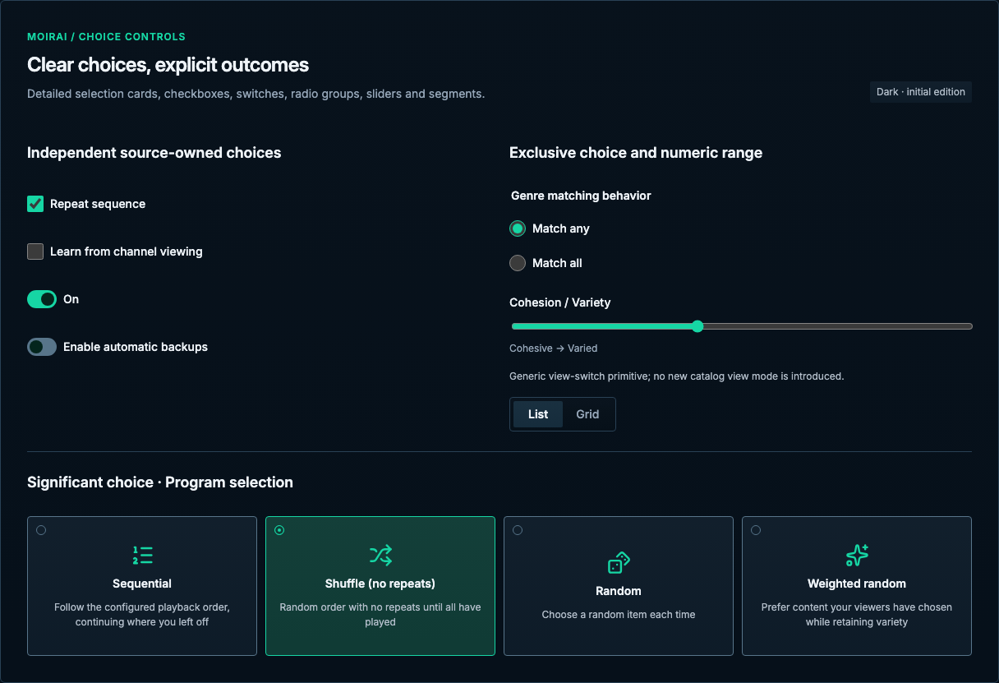

# Choice controls

[Handbook](../README.md) · [Live specimen](../index.html?family=choices) · [Full layout](../images/layouts/editor.png)

## Current UI baseline

Keep checkboxes, radio groups and the existing switch/selection semantics. List/Grid is a view choice and shares the reviewed segmented track. A draft-owned switch stays draft-local until Save.

Source owners: [TwoStepActionButton.vue](../../../apps/web/src/components/TwoStepActionButton.vue), [_library.scss](../../../apps/web/src/styles/_library.scss).

Apply [the current-UI mapping and reviewed unifications](../docs/current-ui.md) before the component parameters below. Numeric radii describe the baseline; the active half-radius trial remains a separate override.

## Purpose and anatomy

Use independent checkboxes for membership or draft flags, radio groups for one mutually exclusive value, switches for an on/off setting, sliders for genuinely continuous values, and segmented buttons for a small peer choice such as view mode.

## Parameters and variants

| Component        | Standard                                                                        | Label and content                                                                                                    |
| ---------------- | ------------------------------------------------------------------------------- | -------------------------------------------------------------------------------------------------------------------- |
| Checkbox         | 20px native box; 8px label gap; 42px row                                        | 44px row on mobile; indeterminate only for partially selected groups                                                 |
| Radio            | 20px native circle; same row geometry                                           | Group with `fieldset` and `legend`; one named value                                                                  |
| Switch           | 36×22px track, 16px thumb, 3px inset, 14px travel                               | 42px row desktop / 44px mobile; mint when on                                                                         |
| Slider           | Native range, 100% field width, accent fill                                     | Visible label, endpoint meaning and value / units when meaningful                                                    |
| Segmented choice | Intrinsic width, equal adjoining segments, 4px inset, no gaps; 8px track radius | 32px desktop / 44px phone segment target; 4px inner radius; filled selection with primary text, no individual border |

## Detailed choices for significant decisions

Prefer the existing Program strategy-card pattern when a small set of choices substantially changes
behavior and people benefit from comparing the consequences. Keep the options visible together,
with a meaningful icon, short title, concise explanation and persistent selected indicator. Use it
for Content Program selection and Sequence ordering; apply the same anatomy to other significant
choices when their differences warrant explanation. This is a selection control, not a row of actions:
its icons remain appropriate even though supporting action buttons stay text-only.

Source owners: [SelectionStrategyEditor.vue](../../../apps/web/src/components/programs/SelectionStrategyEditor.vue),
[SequenceOrderingEditor.vue](../../../apps/web/src/components/programs/SequenceOrderingEditor.vue),
[_program-editor.scss](../../../apps/web/src/styles/_program-editor.scss).

| Choice type                                                   | Preferred presentation      |
| ------------------------------------------------------------- | --------------------------- |
| Significant behavior, few options with meaningful differences | Detailed choice cards       |
| Simple peer view choice such as List / Grid                   | Connected segmented control |
| Short routine mutually exclusive values                       | Radio group                 |
| Long or secondary value list                                  | Select / combobox           |

Card parameters follow the current Program control: 170px minimum height, 18px vertical / 12px
horizontal padding, 10px internal and inter-card gaps, 29px Lucide icon, 1px control boundary and
`--radius-control` (8px baseline, 4px in the active trial). Use `--font-control` / `--line-control`
for titles, `--font-small` / `--line-small` and secondary text for explanations. The shared surface
gradient overlays raised fill; selected uses mint border, selected fill and a 12px selection marker
at a 10px top/left inset. Never rely on fill color alone. Keyboard focus remains the global outline;
hover uses the hover fill, pressed uses selected fill, and disabled retains its selected value at
standard disabled opacity. Invalid/busy feedback belongs to the containing group or editor.

The reference matches the existing native-button `aria-pressed` behavior: all available cards remain
in Tab order; Enter/Space select exactly one option without moving focus. The group has an accessible
name; each button names its title and associates its explanation with `aria-describedby`. Do not add
radio roles without also implementing their arrow-key and roving-focus behavior. Selection changes
the draft in an editor, preserving the normal Reset / Save flow. Keep dependent controls, such as a
stable seed, next to the group with their existing conditional behavior.

Show four equal columns on wide surfaces and two at or below 900px, matching the current source. Let
cards grow for longer text; wrap explanations and keep full labels visible. Avoid horizontal scrolling
or shrinking type to preserve a grid. No additional selection animation is required.

The live [choice specimen](../index.html?family=choices) shows the current Sequential / Shuffle /
Random / Weighted random strategy descriptions. The [Program specimen](../index.html?family=programs)
shows the distinct Ordered / Shuffled blocks / Shuffled allocations / Balanced rotation meanings.
Do not merge these into a single invented ordering model.

## States and behavior

Unchecked / off uses the control boundary; checked / on uses mint and an explicit check or changed thumb position. Radio selection is exclusive. Native checkbox supports mixed state when assigned by the application; `aria-checked="mixed"` must match the visual state for custom controls. Disabled state retains the selected value and explains why it cannot change. Busy state belongs to the containing operation rather than an animated switch. Invalid group feedback appears below the group and is associated with it.

Space toggles a focused checkbox or switch. Native radio groups support arrows and Space. Sliders support arrows and Home/End through the native control. Segmented choices here use individual toggle buttons and `aria-pressed`; do not apply tab semantics when no tabpanels exist. View choices should not trigger unrelated resource mutations.

The segmented control is one compact shared track, not a full-width box or a row of individually
outlined buttons. Its selected segment uses `--color-hover` fill and primary text at weight 600;
inactive labels use muted text at weight 500. Its total height is 42px desktop and 54px phone,
including the 4px inset and 1px track boundary. Retain a distinct focus ring for keyboard use.

## Draft versus immediate settings

Inside a Save-based resource editor a switch changes the draft; it does not silently persist. Outside an editor, an immediate switch needs explicit progress, error recovery and clear persistence semantics. The gallery demonstrates draft choices only. Selection in a media catalog is a checkbox rather than a switch.

## Adaptation and edge behavior

Wrap labels beside the control, allowing height to grow while keeping the control aligned to the first line. At ≤600px use 44px interaction rows, and wrap or stack segmented choices if they cannot fit. Never shrink the 20px glyph to fit a label. Reduced motion makes thumb movement effectively immediate. Native control rendering may vary; use the documented geometry and semantic states when implementing a custom visual treatment. See [shared behavior](../docs/behavior.md).

All numeric values are CSS pixels at the default root size unless expressed in rem. Exact token values are indexed in [the token reference](../docs/tokens.md).

## Narrow reference captures

[390px specimen](../images/specimens/choices-390.png) · [320px specimen](../images/specimens/choices-320.png)
