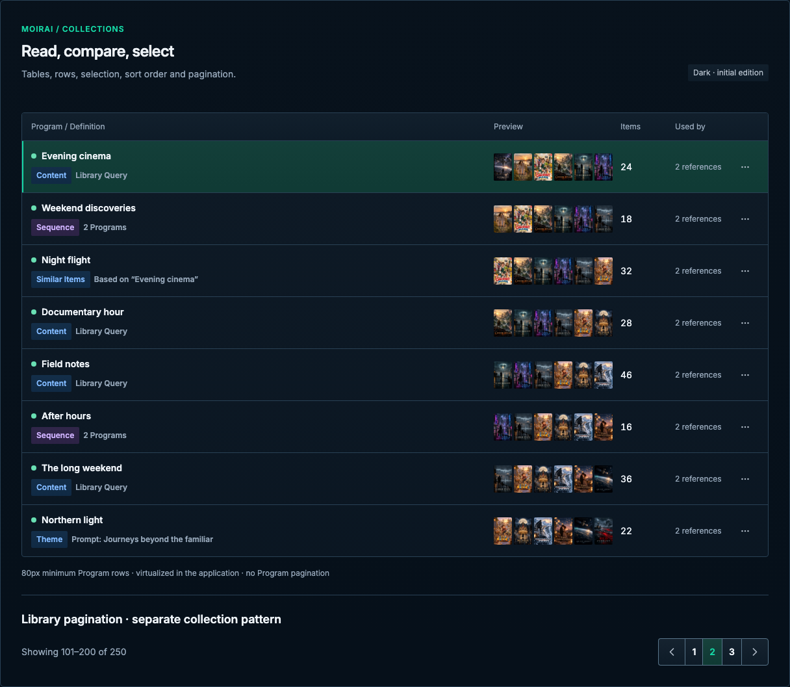

# Collections

[Handbook](../README.md) · [Live specimen](../index.html?family=collections) · [Full layout](../images/layouts/catalog.png)

## Current UI baseline

Programs is the existing overview list: Program / Definition, Preview, Items, Used by and row actions, with an 80px minimum row and inline inspection when space permits. Its live implementation is virtualized, not paginated. Library pagination is a separate pattern.

Source owners: [ProgramCatalogList.vue](../../../apps/web/src/components/programs/ProgramCatalogList.vue), [_program-management.scss](../../../apps/web/src/styles/_program-management.scss).

Apply [the current-UI mapping and reviewed unifications](../docs/current-ui.md) before the component parameters below. Radii use the permanent 2 / 4 / 6 / 8px scale for small / control / panel / dialog corners.

## Purpose and anatomy

Use tables when users compare several attributes and lists when the primary task is recognizing one resource. A table owns a caption, column headers, rows, resource identity, relevant metadata and row actions. Pair an inspector with explicit selection rather than crowding every detail into a row.

## Parameters and variants

| Element            | Current pattern / unified geometry                     | Behavior                                                       |
| ------------------ | ------------------------------------------------------ | -------------------------------------------------------------- |
| Program list frame | 1px structural border; normalized 4px radius           | Scrollable source-owned overview; uses `--radius-control`      |
| Header / columns   | Program / Definition, Preview, Items, Used by, actions | 12px text, 10px vertical / 14px horizontal inset               |
| Program row        | 80px minimum; 12px gaps                                | Native identity button, selected state and independent actions |
| Preview            | Two or more 28×42px thumbnails, 3px gap                | Supporting artwork, not an invented duration column            |
| Identity           | Name, status dot, type and definition badges           | Resource title and definition stay associated                  |
| Counts             | Items and usage references                             | Tabular figures for comparative numeric data                   |
| Pagination         | Library pattern: 32px desktop / 44px touch controls    | Shown separately on this board; Programs itself is virtualized |

Pagination labels, page indicators and navigation actions share a vertical center. Keep the row's
alignment independent of badge rules for vertical stacks. On phone let the count and navigation group
wrap onto separate rows with a consistent 16px gap; do not stretch a badge to match button height.

The generic table primitive retains `--row-height: 56px` for future composition. It is not the
Program catalog measurement: source-owned Program rows use an 80px minimum and grow for compact
mobile content. No new table view is introduced in Moirai.

## State matrix and selection

Default rows use the surface background; hover uses hover fill. Selected rows use selected fill plus a 2px mint leading edge and an explicit accessible selection indication. Keep hover and selection distinguishable. In a production selectable table use a checkbox for multi-selection; for opening an inspector use a named button or link in the identity cell. Do not rely on pointer-only row clicks. The board shows the source-shaped Program overview list with a fixed selected row; it does not simulate virtualization or full inspector selection.

A sort action belongs in a column header button and exposes `aria-sort` on the active header. Do not display sort arrows without an actual order. Pagination is disabled while a conflicting page load is pending; preserve loaded records on a later failure when feasible, with the error in context. The separate pagination specimen represents page 2 of a three-page library result (101–200 of 250, at 100 per page), with both directions available. Its buttons illustrate the multi-page state without fetching another fixture page. Join controls with zero gap and one shared divider per boundary; the selected page retains its left border, including beside a disabled neighbor. Do not add it to the Program overview.

## Adaptation and edge behavior

At narrow widths preserve the source-owned compact Program list. Media libraries retain their two-column artwork grid. If comparison requires a table, provide a named keyboard-scrollable region and retain the identifier column. Do not hide essential attributes without another accessible route. Long resource names wrap; row actions have a named 42px target desktop / 44px mobile. Keep tooltips and focus rings outside clipping ancestors where possible. Virtualized production collections must preserve semantic reading order, focus and scroll stability; this reference uses ordinary rows.

Use [feedback](feedback.md) for initial loading, loaded-empty and failure presentations and [metadata](metadata.md) for inspector composition.

All numeric values are CSS pixels at the default root size unless expressed in rem. Exact token values are indexed in [the token reference](../docs/tokens.md).

## Narrow reference captures

[390px specimen](../images/specimens/collections-390.png) · [320px specimen](../images/specimens/collections-320.png)

Library selection is an explicit mode: preserve normal per-card + actions as well as full-card bulk toggles with a top-right checkbox. See [both media modes](media.md#normal-browsing-and-bulk-selection). Cancelling bulk selection clears its temporary selection and restores single-item actions.
