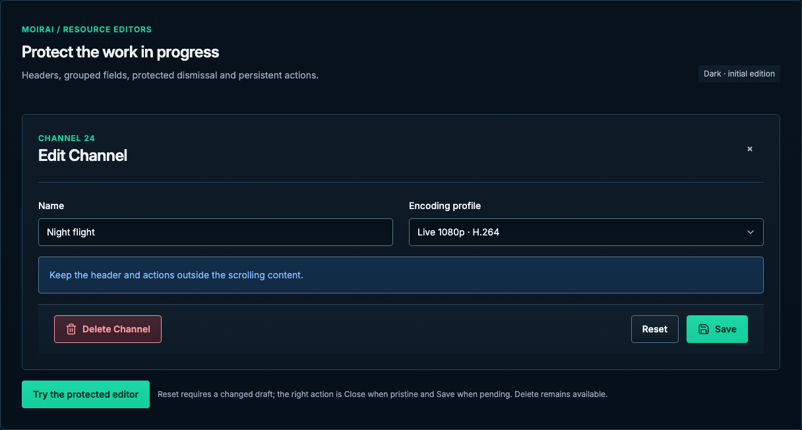

# Resource editors

[Handbook](../README.md) · [Live specimen](../index.html?family=editor) · [Full layout](../images/layouts/editor.png)

## Current UI baseline

Preserve the current channel-editor grouping and the resource action bar: Delete at left, two-step Reset and Save/Close at right. A valid pending draft enables Save; no pending draft exposes Close. SettingsSaveFooter remains Save-based and does not inherit this Close behavior.

Source owners: [ChannelsPage.vue](../../../apps/web/src/views/ChannelsPage.vue), [ResourceEditorActionBar.vue](../../../apps/web/src/components/ResourceEditorActionBar.vue).

Apply [the current-UI mapping and reviewed unifications](../docs/current-ui.md) before the component parameters below. Numeric radii describe the baseline; the active half-radius trial remains a separate override.

## Purpose and anatomy

A resource editor owns a saveable draft, captured baseline, validity, pending work and dismissal. Its header identifies the resource, its body groups related fields, and its persistent bottom bar owns destructive and save actions. The prototype owns local in-memory values only.

## Parameters and composition

| Section | Standard                                                                               | Ownership                                              |
| ------- | -------------------------------------------------------------------------------------- | ------------------------------------------------------ |
| Surface | 820px max width, 16px radius, control border, dialog shadow                            | Bounded to dynamic viewport                            |
| Header  | 24px inset, 24/32px title, top-right 42px close                                        | Resource context, task name, optional description      |
| Body    | 24px inset / section gaps, 16px field gaps                                             | Only this region scrolls                               |
| Columns | Number / Name / Group identity row; feature-owned sections below; one column at ≤600px | Identity first, then behavior, then advanced choices   |
| Footer  | 16px vertical / 24px horizontal inset, raised surface, top divider                     | Delete at left; Reset then Save/Close at right         |
| Phone   | 8px outer gutter, 16px content inset, 12px action inset                                | 44px targets; delete row above Reset/Save if necessary |

## Draft state contract

Capture the baseline when the editor opens or a save succeeds. Enable Reset only when the draft differs. Show Close when the resource draft is unchanged; show Save when pending, enabled only when valid. During conflicting work disable Save and Reset and retain the draft. On save failure keep the editor open and show a persistent contextual error. Successful saves update the baseline and show a dismissible toast.

Reset first changes to a checkmark plus “Reset” in caution styling, with the accessible name “Confirm reset channel draft” and `aria-pressed="true"`; the second activation restores the baseline. Cancel arming with blur, Escape, outside interaction, another armed action or 5 seconds. Cancellation restores the original label and `aria-pressed="false"`. Reset restores select, numeric, text and checkbox values together.

The close icon, backdrop dismissal and Escape all call the same guard. A clean draft closes directly. A dirty draft opens “Discard unsaved changes?”; Keep editing preserves all values and returns focus; Discard closes. Permanent Delete remains available with an invalid or dirty draft and opens its own resource-specific modal. On cancellation preserve the draft. On confirmation deletion discards the draft as part of removing the resource.

## Accessibility and edge behavior

Label the dialog from its heading; use proper field labels, described errors and initial focus on the first meaningful field. Keep focus within the modal and return it to the opening action. Long titles wrap without pushing the close icon offscreen. At small heights the body scrolls while actions remain reachable. The mobile scrolled screenshot demonstrates this relationship.

## Working prototype boundary

The live example exercises dirty tracking, validity, reset arming, guarded dismissal, deletion confirmation, baseline updates and success notifications. It does not persist to the app, execute asynchronous saving, simulate server conflicts or validate full channel domain constraints. Other resource types follow the same presentation and ownership rules; their fields come from their own contracts. See [shared behavior](../docs/behavior.md).

All numeric values are CSS pixels at the default root size unless expressed in rem. Exact token values are indexed in [the token reference](../docs/tokens.md).

See the [dirty-draft confirmation](../images/specimens/discard-confirmation.png) and
[permanent deletion confirmation](../images/specimens/delete-confirmation.png) for the two distinct
modal decisions.

Two-step Reset preserves its unarmed size, shape and position. A longer confirmation label must not
shift Save / Close or resize the footer. The full accessible confirmation name remains available even
when only a checkmark fits visually; see [actions](actions.md).

## Channel section contracts

| Section                   | Current controls and conditions                                                                                                                                             |
| ------------------------- | --------------------------------------------------------------------------------------------------------------------------------------------------------------------------- |
| Identity                  | Number, Name, Group suggestions; enabled switch in header; resource-specific contextual help                                                                                |
| Schedule                  | Manage Layered Schedule only when an existing channel has no pending draft; otherwise disabled with a save-first explanation                                                |
| Logo                      | Choose Image, current/selected image, crop workspace and pixel size, Choose Another, two-step removal; PNG on save and configured size cap                                  |
| Subtitles                 | Off / Prefer default / Any matching track / Forced only; language and title rules hidden while Off; specific rules reveal language combobox or title text                   |
| Presentation              | Burn/Convert and Subtitle fonts folder, within Subtitles                                                                                                                    |
| Check against media       | Preview library/search and selected video; Program variant additionally owns preview channel/ancestor context; metadata-only evaluation                                     |
| Music video credits       | Independent switch and required Credit template when enabled; Burn while enabled, retained Convert preference                                                               |
| Audio selection           | Preferred language code and Preferred audio title, with language-code and partial-title guidance                                                                            |
| Encoding profile          | Audio and video settings selector; Manage Encoding Profiles; linked settings read-only, Custom exposes editable Video/Audio controls and acceleration/loudness dependencies |
| Guide template override   | XMLTV layout, default/unavailable states, Manage Guide Templates                                                                                                            |
| Channel fallback override | Effective fallback status, replacement-file selection, remove-on-save and persistent load/validation failures                                                               |

[Actual crop workspace](../images/source-audit/channel-logo-crop.png) is source comparison evidence,
not a redesigned cropper. The standalone guide demonstrates native file selection and the current
section/control geometry; crop manipulation, media probes, encoding diagnostics and actual track
checks stay with their application owners. Full encoding field names and conditions follow
EncodingSettingsEditor; no Frame rate or MPEG-2 option is introduced by this guide.

The Channel editor preserves its source presentation: vertical Schedule label/action, bordered logo
picker with PNG/size guidance, framed Subtitles/Audio/Encoding fieldsets, and 48px circular disclosure
icons beside title/subtitle text and a trailing chevron. Channel disclosure frames are distinct from
bezel-free Settings heading icons. Policy cards have a compact 114px minimum; the Off fixture keeps
selection rules hidden and Presentation open. The radius trial and shared subtle finishes still apply.
