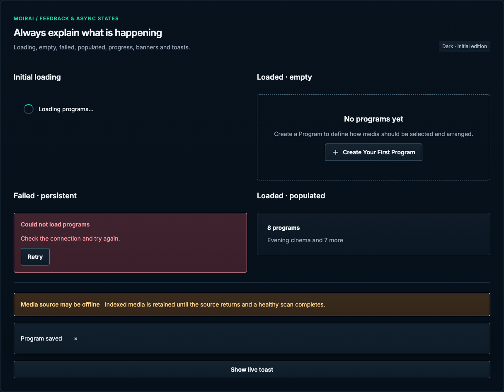

# Feedback & asynchronous states

[Handbook](../README.md) · [Live specimen](../index.html?family=feedback) · [Full layout](../images/layouts/settings.png)

## Current UI baseline

Use the existing LoadingState, ResourceEmptyState and TransientToast ownership. Initial loading is not empty; failures stay contextual and persistent. Completion notifications remain dismissible and transient.

Source owners: [LoadingState.vue](../../../apps/web/src/components/LoadingState.vue), [ResourceEmptyState.vue](../../../apps/web/src/components/ResourceEmptyState.vue), [TransientToast.vue](../../../apps/web/src/components/TransientToast.vue).

Apply [the current-UI mapping and reviewed unifications](../docs/current-ui.md) before the component parameters below. Radii use the permanent 2 / 4 / 6 / 8px scale for small / control / panel / dialog corners.

## Purpose and anatomy

Explain what is known, what is happening and what the user can do next. A collection has four distinct conditions: initial loading, successful empty, successful populated, and failed. Action confirmation is separate from durable system status.

## Parameters and variants

| Element           | Standard                                                                         | Use                                                                 |
| ----------------- | -------------------------------------------------------------------------------- | ------------------------------------------------------------------- |
| Empty state       | 208px specimen minimum, 24px inset, 12px gaps, 6px radius, dashed control border | Short title, explanation and useful action; grow for content        |
| Loading indicator | 24px spinner with visible status text                                            | Explicit loading label and `aria-busy`; no empty count              |
| Banner            | 16px inset, 12px gap, 4px radius, 1px semantic boundary                          | Persistent errors, warnings and states requiring attention          |
| Toast             | Same inset and radius, raised fill, control boundary, popover shadow             | Success only; 5-second read time; manual close                      |
| Progress          | 8px visual track; visible numeric / textual status                               | Native progress semantics; determinate only when the total is known |

## State and announcement rules

On first load, show “Loading programs…” without “0 programs” or an empty illustration. After successful completion show the real count or a meaningful empty state. A failed first load shows a persistent contextual error and Retry, not the empty state. During refresh, previously loaded content may remain with a refreshing indicator; do not claim it is fresh after failure.

Use a polite status announcement for completion; use an alert for a meaningful newly appearing blocking failure. Avoid announcing static fixture alerts repeatedly. A success toast does not require focus and must not obscure the triggering action. Pause the 5-second timer while hovered or focused; manual dismissal remains possible. An error is never automatically dismissed. If a background task finishes, preserve task identity in its confirmation.

## Progress and busy behavior

Known progress shows completed/total or percentage with units. Unknown progress uses an indeterminate state and text rather than invented precision. Do not equate FFmpeg launch with playable output or show service readiness before delivery is confirmed. Disable conflicting actions during work; preserve error messages until resolved or deliberately dismissed.

## Adaptation and motion

Toast width is bounded by viewport gutters; at ≤600px use 16px left/right/bottom insets. Banners wrap message and actions instead of truncating repair instructions. Empty states grow with text size. Loading uses the source spinner and explicit status text; no skeleton replacement is introduced. Reduced motion has no meaningful translation. The live toast is functional; Retry, scan progress and backend async transitions are visual specimens with the production contract described here.

See [shared behavior](../docs/behavior.md) for announcement, focus and motion requirements.

All numeric values are CSS pixels at the default root size unless expressed in rem. Exact token values are indexed in [the token reference](../docs/tokens.md).
