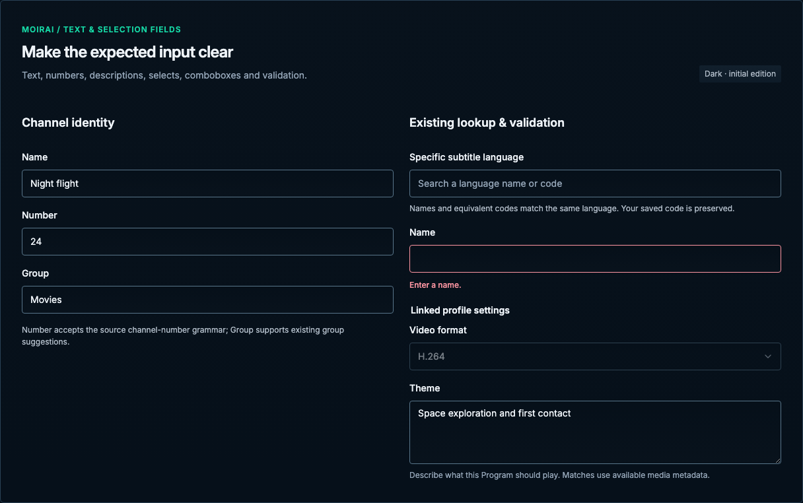

# Text & selection fields

[Handbook](../README.md) · [Live specimen](../index.html?family=fields) · [Full layout](../images/layouts/editor.png)

## Current UI baseline

The channel editor begins with Number, Name and Group, then schedule access, logo, subtitles, encoding profile, guide template and channel fallback. Do not add a per-channel Guide title or Description field because a mockup looked plausible.

Source owners: [ChannelsPage.vue](../../../apps/web/src/views/ChannelsPage.vue), [LibraryFields.vue](../../../apps/web/src/components/library/LibraryFields.vue).

Apply [the current-UI mapping and reviewed unifications](../docs/current-ui.md) before the component parameters below. Numeric radii describe the baseline; the active half-radius trial remains a separate override.

## Purpose and anatomy

Use a visible label, input boundary, current value, optional helper, and adjacent validation message. The label describes the expected value; placeholder text is an example, never a substitute. Preserve a user's draft when a submission fails.

## Parameters and variants

| Component           | Parameters                                                                   | Use and constraints                                                                                  |
| ------------------- | ---------------------------------------------------------------------------- | ---------------------------------------------------------------------------------------------------- |
| Text / URL / search | 42px minimum; 12px horizontal / 8px vertical inset; 8px radius               | 14/20px, text on canvas, 1px control border                                                          |
| Number              | Same geometry, numeric type                                                  | Specify units and domain bounds nearby; validate semantics at trust boundary                         |
| Textarea            | 96px minimum height; same insets                                             | Vertical resize, wrap authored paragraphs                                                            |
| Select              | Same geometry; 16px trailing Lucide caret, 12px edge inset, 40px end padding | Small known set; visible label; preserve native keyboard support                                     |
| Combobox            | Same geometry; optional 20px search icon                                     | Filterable lookup for larger sets; SubtitleLanguageCombobox pattern with local language-name fixture |
| Label / helper      | 14/22px 500 / 12/18px 400                                                    | 8px label gap; helper uses muted text                                                                |
| Field group         | 16px field gap, 24px section gap                                             | 560px recommended max for a single text field                                                        |

Every select uses the shared `.select-control` presentation in all layouts and specimens, including catalog filters, Settings and resource editors; Library sort uses its existing action menu. The native select remains the interactive control; the decorative caret ignores pointer events and is vertically centered. Native indicators return in forced-colors mode.

## States and validation

Default inputs have a control border. Hover may strengthen the border; focus adds the global ring without removing the boundary. Disabled fields use native disabled semantics and explain ownership; readonly fields remain selectable. Invalid inputs use a danger border, `aria-invalid` and `aria-describedby` pointing to the error. Include a plain-language repair instruction, not only an icon or color. Show errors after meaningful validation, not on an untouched optional field. During a save, disable conflicting changes and preserve values. Required fields must be communicated in the label or form instructions and validated before Save.

## Keyboard and selection behavior

Use native input, textarea and select semantics. The existing custom language combobox exposes expanded state and active option, support typing, arrow navigation, Enter, Escape, clear selection and focus return. Search may change results; a selection field commits a value. Keep these purposes distinct. The local lookup exercises named options and two/three-letter code fallback; the application owns the full ISO language dataset and ambiguity rules. Group suggestions remain a native datalist.

## Responsive and edge behavior

Fields fill their grid cell; two columns collapse to one at ≤600px. Mobile inputs have a 44px minimum target. Long labels and errors wrap and grow the group. Use `min-width: 0` within grids to prevent values from expanding the layout. Store full values even when native single-line inputs scroll internally. Do not reduce font size to fit. The gallery validates representative channel identity values; production-specific URL, identifier and uniqueness validation remains in the application.

See [the shared contract](../docs/behavior.md) and [resource editors](editor.md) for pending validity, save failures and draft protection.

All numeric values are CSS pixels at the default root size unless expressed in rem. Exact token values are indexed in [the token reference](../docs/tokens.md).
