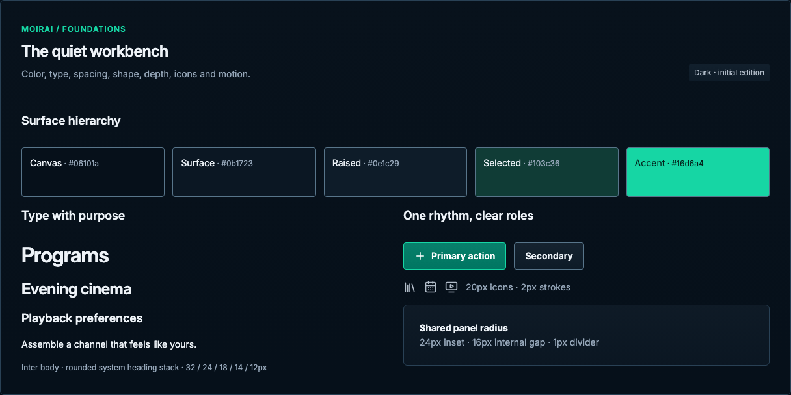

# Foundations

[Handbook](../README.md) · [Live specimen](../index.html?family=foundations) · [Full layout](../images/layouts/catalog.png)

## Current UI baseline

Navy semantic surfaces, mint emphasis, Inter body text and the rounded-heading fallback stack come from the existing web styles. The source-owned wordmark uses Georgia and the existing Moirai logo; do not replace it with a new mark.

Source owners: [_tokens.scss](../../../apps/web/src/styles/_tokens.scss), [_foundation.scss](../../../apps/web/src/styles/_foundation.scss).

Apply [the current-UI mapping and reviewed unifications](../docs/current-ui.md) before the component parameters below. Radii use the permanent 2 / 4 / 6 / 8px scale for small / control / panel / dialog corners.

## Purpose and anatomy

Build a calm workbench for a media administrator. Content, timing and task state should dominate; decoration should not compete with artwork. Use the canvas as the frame, surfaces for task groups, and raised surfaces for controls or floating content. Mint identifies the next action, selected context and focus; it is not a background wash for whole screens.

## Parameters

| Primitive               | Standard                                     | Composition rule                                                               |
| ----------------------- | -------------------------------------------- | ------------------------------------------------------------------------------ |
| Page title              | `--font-page` / `--line-page`, 600, −0.025em | 32/40px; one per page                                                          |
| Dialog / resource title | `--font-title` / `--line-title`, 600         | 24/32px; name the task                                                         |
| Section title           | `--font-section` / `--line-section`, 600     | 18/26px; group a responsibility                                                |
| Body / control          | 14/22px body, 14/20px control                | `--font-body`, `--font-control`; 400 body, 600 actions                         |
| Supporting text         | `--font-small` / `--line-small`, 400         | 12/18px; never the only place essential instructions appear                    |
| Spacing                 | 4, 8, 12, 16, 20, 24, 32, 40, 48, 64px       | Use `--space-*`; 2px title/subtitle gap and optical icon alignment             |
| Shape                   | 2 / 4 / 6 / 8px                              | Badges / controls / panels / dialogs; pill only for switch tracks and dots     |
| Borders                 | 1px                                          | `--color-line` structural; `--color-control` for identifiable input boundaries |
| Focus                   | 2px mint, 3px offset                         | `--focus-width`, `--focus-offset`; never clip the ring                         |
| Icons                   | 16 / 20 / 24px, 2px stroke                   | Inline / control / feature; Lucide only, no mixed filled sets                  |
| Elevation               | Popover or dialog shadows                    | Ordinary panels have no shadow; see token reference                            |

## Color and content

Eyebrows use `--color-accent` mint consistently in page, editor and section headings, matching the current application. Keep secondary or muted coloring for supporting prose and metadata rather than applying it to the shared eyebrow class.

Use `--color-text` for primary content, `--color-secondary` for supporting prose, and `--color-muted` for metadata. All three are intended for canvas, surface, raised, hover and selected backgrounds. Primary buttons use the deeper green `--color-primary` fill and white `--color-on-primary` labels and icons. Hover uses `--color-primary-hover`, and pressed uses `--color-primary-pressed`; keep the shared subtle button gradient. Bright mint accents, selection markers and switches use their existing accent roles, including dark `--color-on-accent` on bright mint fills. Semantic info, success, warning, danger and purple labels use their paired dark surfaces. Purple identifies program categories or layers, not an additional primary action.

Body text uses locally bundled Inter normal variable 100–900. Headings preserve `ui-rounded`, `SF Pro Rounded`, Inter and system fallbacks; the wordmark stays Georgia. Heading fallback is platform-dependent, so captures record their environment; standard weights are 400/500/600/700. Use the system monospace stack only for logs, technical identifiers and code. Numbers in comparative columns use tabular figures. At a 16px root the rem values above match the listed pixels. Respect larger browser defaults and zoom; do not set the root to a fixed size.

Prominent primary and destructive actions use an 18px Lucide glyph beside the verb; secondary and subdued actions stay text-only. See [action icon rules](actions.md#icons-for-prominent-actions). Keep glyphs decorative and color-matched to their labels.

Keep supporting subtitles within `--title-subtitle-gap` (2px) of their title, including disclosure headers, encoding section legends and card summaries. Do not reuse a field-grid or section gap between these two lines. Encoding legends use a 1.3 title line height and 1.4 subtitle line height; retain normal wrapping without spacer rows or fixed heights.

## Surface finish

Use subtle vertical gradients throughout the rendered reference. Semantic colors remain the base;
these low-opacity overlays add a little depth without beveled edges or raised ordinary panels.

| Role                       | Token                       | Overlay from top to bottom | Applies to                                                                                        |
| -------------------------- | --------------------------- | -------------------------- | ------------------------------------------------------------------------------------------------- |
| Canvas / navigation        | `--canvas-gradient`         | White 0.8% → black 1%      | Page canvas, specimen board, desktop rail and mobile bar                                          |
| Content / floating surface | `--surface-gradient`        | White 1.5% → black 2.5%    | Panels, cards, badges, selected rows, timeline blocks, dialogs, persistent bars, menus and toasts |
| Fields                     | `--field-gradient`          | Black 2.5% → white 1%      | Text/numeric inputs, selects and textareas                                                        |
| Filled actions             | `--button-surface-gradient` | White 3% → black 4%        | Primary, secondary, destructive and armed buttons                                                 |

Gradients follow each container’s vertical extent and retain semantic hover/selected/error fills.
Transparent utility icons, text links and menu rows inherit their surroundings; they do not gain
individual frames or sheen. Keep status dots, focus outlines, separators and text solid. Artwork keeps
its own treatment. Do not animate the gradient or add button shadows, bevels or text shadows.
The permanent corner scale applies independently of this finish.

## Interaction, accessibility and adaptation

Follow [the shared behavior contract](../docs/behavior.md) for states, focus and responsive rules, and the [motion standard](../docs/motion.md) for transitions, timing and reduced motion. Static color blocks and type specimens have no interactive states. Interactive components must inherit focus and disabled rules instead of redefining them. Status needs a text label or icon in addition to color. Artwork is clipped inside its own frame; control focus remains outside it.

Use concise sentence case, explicit verbs and resource names. Prefer “Delete channel” over “OK”; distinguish “Save” from “Review Selection.” Preserve user-authored spelling and title case in names. Show durations with units and identify the timezone near a timeline. Do not invent unavailable counts or completion estimates.

## Reviewed unifications

The app supplies the composition and ownership baseline. Shared styling consolidates its small differences in control heights, radius values, text roles and boundaries. Previously reviewed flat-shaped action treatments with a subtle gradient, bezel-free utility/heading icons and segmented view choices remain explicit user-approved unifications. The reviewed smaller corner scale is permanent. See the source comparison in [current UI](../docs/current-ui.md); the [application adoption](../docs/application-adoption.md) now implements these reviewed rules while preserving source-owned workflows.

All numeric values are CSS pixels at the default root size unless expressed in rem. Exact token values are indexed in [the token reference](../docs/tokens.md).
