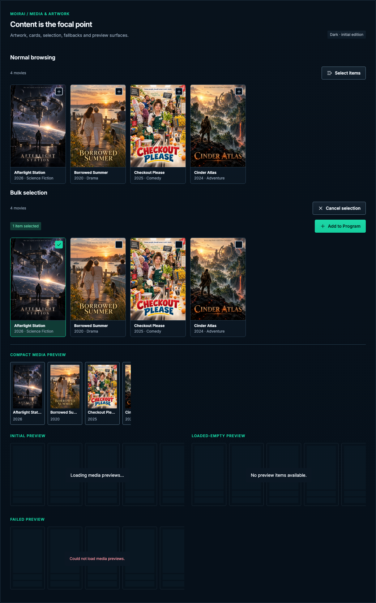

# Media & artwork

[Handbook](../README.md) · [Live specimen](../index.html?family=media) · [Full layout](../images/layouts/library.png)

## Current UI baseline

Preserve the catalog-virtualization contract: 170px minimum desktop tiles, 14px column gaps and two columns at or below 700px. Artwork remains 2:3 with compact metadata and distinct top-right add and bulk-selection affordances.

Source owners: [LibraryMediaCard.vue](../../../apps/web/src/components/library/LibraryMediaCard.vue), [catalog-virtualization.ts](../../../apps/web/src/catalog-virtualization.ts).

Apply [the current-UI mapping and reviewed unifications](../docs/current-ui.md) before the component parameters below. Numeric radii describe the baseline; the active half-radius trial remains a separate override.

## Purpose and anatomy

Let content artwork lead recognition while titles, type and duration remain readable without relying on the image. A media card contains an artwork frame, title, supporting metadata and an optional explicit selection control. Selection is distinct from preview or navigation.

## Parameters and variants

| Element           | Standard                                                               | Composition                                                                                                                      |
| ----------------- | ---------------------------------------------------------------------- | -------------------------------------------------------------------------------------------------------------------------------- |
| Media grid        | `--media-card-min` 170px; `--media-card-column-gap` 14px; row gap 13px | Fill available columns; two columns at ≤700px                                                                                    |
| Card              | No outer inset; 12px clipping radius; 1px structural border            | Artwork reaches the frame edges; compact metadata beneath                                                                        |
| Poster            | 2:3 aspect                                                             | Preserve image proportions with `object-fit: contain`; no stretching                                                             |
| Landscape preview | 16:9 aspect, 8px radius                                                | Dedicated landscape/player surface; compact carousel uses portrait artwork                                                       |
| Metadata area     | 8px vertical / 12px horizontal inset                                   | Title and supporting facts; 12/18px text                                                                                         |
| Title             | 12/18px 600, one line                                                  | Ellipsis visually; preserve full text and accessible selection name                                                              |
| Card affordance   | 25px visual frame, 2px border, 9px top/right inset; `--radius-control` | Normal: + in 42px target / 44px on phone. Bulk: full-card toggle with checkbox visual; selected card gets mint boundary and fill |

Sizing follows the existing public `catalogCardMinimumWidth`, `catalogCardColumnGap`,
`catalogMobileBreakpoint` and `catalogMobileColumnCount` in
`apps/web/src/catalog-virtualization.ts`: desktop columns are
`max(1, floor((availableWidth + 14) / (170 + 14)))`; at viewport widths ≤700px use two columns.
The mobile exception can make tiles narrower than 170px. At a 1440px viewport the full library example
fits six columns rather than the previous four. The catalog sizing contract is checked against the
rendered reference without importing application code into the browser gallery.

## Normal browsing and bulk selection

Preserve both existing library modes. Normal browsing shows a **+ at the top right** of each card;
activating it opens the Program destination chooser for that item alone. It must not enter bulk mode
or select the card. Keep the card’s normal navigation/preview action separate from this sibling control.

**Select items** explicitly enters bulk mode. Replace each + with a top-right checkbox visual and a
full-card toggle button, matching `LibraryMediaCard.vue`’s `aria-pressed` semantics. Disable the underlying
navigation while selection owns the card. Update the accessible name from Select to Deselect with the
full title, and reflect selection with a checkmark and mint border. Space/Enter activate the toggle.
The selection bar shows the actual count, including zero, and disables Add Selected until at least
one item is selected. Cancel selection clears selection and restores normal browsing.

The specimen shows both modes; each has a working toggle. The full library opens in normal mode.
Its destination chooser and Select/Clear Page use local fixtures. Preserve the existing Add Selected and Add All actions in the full library. Group expansion, preview metadata,
server persistence and source-owned selection-toolbar motion remain application behavior. The 25px
frame and 9px inset follow the current card; the shared target size, colors and radius trial normalize
its incidental styling. No shadow is added to the affordance.

[Normal library](../images/layouts/library.png) · [Bulk selection](../images/layouts/library-bulk.png) ·
[390px bulk](../images/layouts/library-bulk-390.png) · [320px bulk](../images/layouts/library-bulk-320.png)

## States and behavior

Default has a structural border. Hover may raise the surface, without scaling artwork or moving neighboring cards. Keyboard focus belongs to an explicit title link, preview action or checkbox. Selected status has a check and border, not color alone. Disabled selection retains content visibility and explains eligibility. Artwork loading uses a stable frame and quiet placeholder; missing artwork uses a meaningful fallback with the title still present. Failure to load an image must not become a failure of the entire collection.

In implementation, artwork adjacent to an identical visible title can have empty alt text. Meaningful stand-alone artwork needs a concise description. The gallery reuses the documentation screenshot posters with matching titles and years; images adjacent to their visible title are decorative (`alt=""`). Do not put a poster’s embedded typography in place of a real title element.

Selection counts and their adjacent Add to program action share a vertical center. Wrap the
explanatory note below them when space is limited, keeping the count/action relationship clear.

## Compact preview carousel

Preserve the existing horizontal media carousel for compact samples in Program inspectors, source
previews and similar contexts. Do not expand a compact sample into a large wrapping artwork grid or
replace it with three static posters. The full library remains the separate browsing grid above.

Source owners: [SimilarItemsPreview.vue](../../../apps/web/src/components/programs/SimilarItemsPreview.vue),
[MediaCardPreview.vue](../../../apps/web/src/components/MediaCardPreview.vue),
[QuickQueryPreview.vue](../../../apps/web/src/components/quick/QuickQueryPreview.vue) and
[_programs.scss](../../../apps/web/src/styles/_programs.scss).

| Part         | Reference standard                                                                                          |
| ------------ | ----------------------------------------------------------------------------------------------------------- |
| Strip        | One non-wrapping horizontal row; 9px `--preview-card-gap`; local overflow and proximity scroll snap         |
| Compact card | 112px `--preview-card-width`, no shrinking; 8px padding, 4px internal gap, 1px control boundary             |
| Artwork      | 2:3 poster; contain without distortion; `--radius-small` inner corners                                      |
| Card shape   | `--radius-control`: 8px baseline / 4px active trial; shared subtle surface gradient                         |
| Identity     | Title and year below artwork; 12/18px reference text, title weight 600; ellipsis with full accessible title |
| Focus        | 6px strip inset leaves room for the shared outline; focus on strip or item link                             |

The 112px / 9px sizing follows the existing Program carousel. Metadata is normalized to the guide’s
readable 12px small-text token rather than the source’s approximately 10–11.5px labels. Keep source-owned
variants: some sequence summaries use short landscape frames, while quick-query previews have their
own virtualized sizing. Do not force every preview owner to use identical artwork dimensions.

Touch/trackpad scrolling stays native. A focused strip supports native horizontal keyboard scrolling;
Tab reaches item links and brings them into view. Opening an item and selecting it for an editor are
distinct actions. No automatic advance or autoplay is introduced. Preserve MediaCardPreview’s existing
metadata behavior, including hover/focus access, pinned info, Escape/outside dismissal and basic
metadata fallback when richer data fails. Those application behaviors are documented here; the gallery
only demonstrates the scrolling/link container with local fixtures.

Keep a stable preview stage for initial loading, loaded-empty, populated and failed states. Loading
must not imply no results; failures remain persistent and distinct from a successful empty response.
Placeholders or retained previews under an unavailable-state overlay are inert and hidden from
assistive technology. The current source owns retry and refresh behavior. Long titles never widen
cards, and the strip must not cause page overflow at 390px or 320px. Keep the carousel’s compact row
at narrow widths rather than converting it to a vertical list.

The [media board](../images/specimens/media.png) shows the compact strip and its asynchronous states;
the [catalog inspector](../images/layouts/catalog.png) and [Program board](../images/specimens/programs.png)
show the same pattern in context.

## Preview and adaptation

A preview surface should identify the item and preserve playback controls, subtitles and aspect ratio. Do not autoplay noisy previews or allow a hover surface to steal focus. Rich preview behavior and player lifecycle remain application responsibilities; the reference specifies their visual container.

At 390px the reference uses two artwork columns; at 320px verify long titles do not force overflow. At 200% text scaling allow fewer columns or taller cards. A card is not a single giant button when it contains other controls. Avoid nesting controls in links. Artwork is copied unchanged from the existing fictitious documentation screenshot fixtures into this folder for standalone, offline rendering. Match the artwork, visible title and fixture metadata; do not label a movie poster with its containing Program name.

Follow [collections](collections.md) for asynchronous collection states and [shared behavior](../docs/behavior.md) for motion and focus.

All numeric values are CSS pixels at the default root size unless expressed in rem. Exact token values are indexed in [the token reference](../docs/tokens.md).

## Narrow reference captures

[390px specimen](../images/specimens/media-390.png) · [320px specimen](../images/specimens/media-320.png)

[390px media library](../images/layouts/library-390.png) · [320px media library](../images/layouts/library-320.png)

The full library preserves LibraryPage's status icons and scan-history button, alphabet strip, sort
menu, filter icon and adjacent bulk-selection icon, plus fixed pagination. It has no invented Browse
selector, normal-mode count row or separate text selection control. See [the library layout recipe](../docs/layouts.md).
