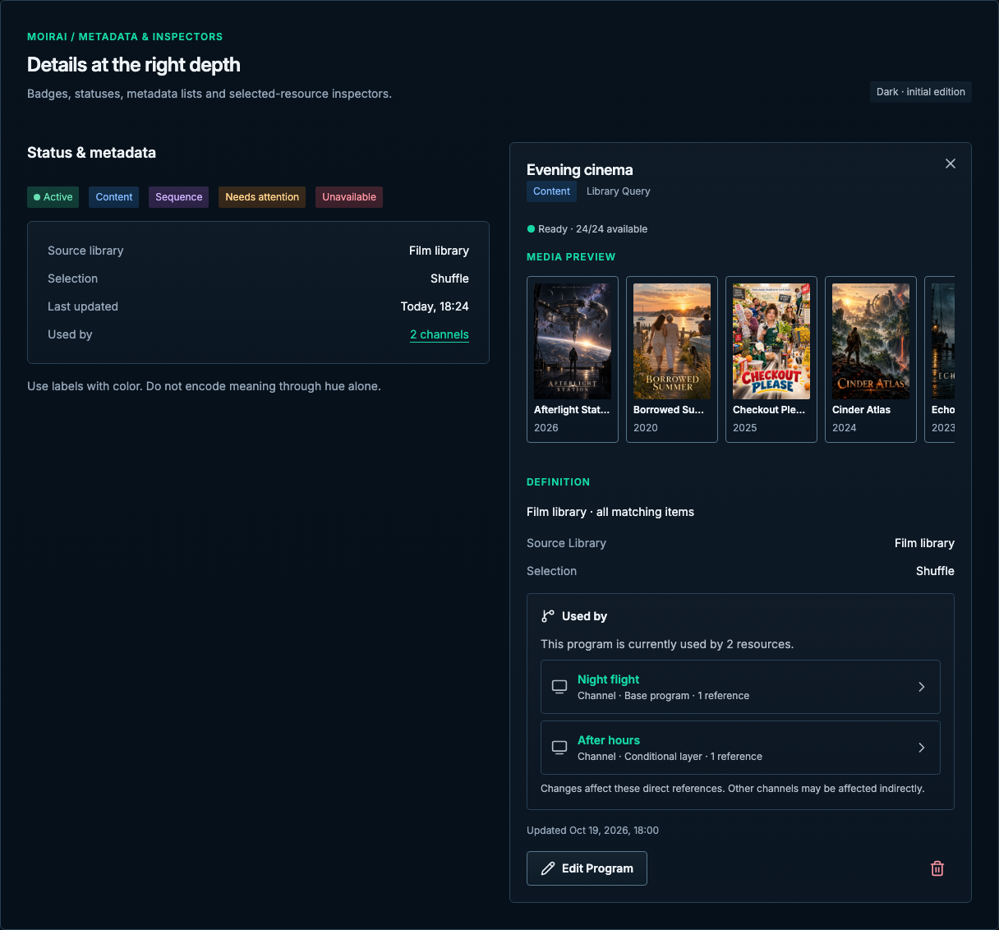

# Metadata & inspectors

[Handbook](../README.md) · [Live specimen](../index.html?family=metadata) · [Full layout](../images/layouts/catalog.png)

## Current UI baseline

The Program inspector presents identity, type/definition, media preview, counts, usage relationships, playback settings and resource actions. Its desktop column is 390px. Keep relationship labels as references, not invented publication states.

Source owners: [ProgramInspector.vue](../../../apps/web/src/components/programs/ProgramInspector.vue), [StatusPill.vue](../../../apps/web/src/components/StatusPill.vue).

Apply [the current-UI mapping and reviewed unifications](../docs/current-ui.md) before the component parameters below. Radii use the permanent 2 / 4 / 6 / 8px scale for small / control / panel / dialog corners.

## Purpose and anatomy

Present secondary facts without making them compete with the resource identity. A status label describes a state; a category badge describes a kind; metadata describes properties. Inspectors expose selected-resource details while preserving the catalog context.

## Parameters and variants

| Component       | Standard                                                                | Use                                                                           |
| --------------- | ----------------------------------------------------------------------- | ----------------------------------------------------------------------------- |
| Badge           | 12/18px, 4px vertical / 8px horizontal, 2px radius                      | Text label; category or state, no unexplained abbreviations                   |
| Status dot      | 8px circle, 4px label gap                                               | Supplemental cue; never sole state indication                                 |
| Semantic pairs  | Info / info surface, warning / warning surface, danger / danger surface | Success uses selected surface; purple uses purple surface                     |
| Metadata list   | `dl`, 12px row gap, 16px column gap                                     | Muted keys, primary values; right-aligned values on desktop                   |
| Inspector       | 390px width; 20px inset; 6px radius                                     | Name/type header, health, media preview, definition, usage and footer actions |
| Inspector title | 18/26px 600, 12px before                                                | Full resource name; close action if transient                                 |

## States and behavior

Status changes update the label and semantic tone together. Unknown / checking is neutral and explicit; do not imply success. If a field is unavailable use a stated “Unavailable” or omit the nonessential field, not a fabricated zero. Clickable relationship counts are links to the related resources; plain counts are not styled as actions.

Keep short status badges on one line, including scan results such as Complete and Cancelled. They must not inherit the arbitrary word-breaking used for long paths or diagnostic messages.

An inspector’s current resource must match the visible selected row. Loading a new selection preserves or marks prior content as stale rather than showing mismatched details. Initial detail loading and failures are explicit. Badge hover and pressed states apply only if the badge is actually a control; ordinary labels must not look interactive. Keyboard focus belongs to actual links and actions.

## Responsive and edge behavior

At ≤1220px the desktop inspector column is removed. Activating the identity control opens the current right-side inspector drawer. The reference exercises this at mobile widths and returns focus to its row. The drawer is 44vw below 1220px, 85vw below 900px, and full width below 680px. Long metadata values wrap with `overflow-wrap: anywhere`; names wrap at word boundaries. On very narrow layouts stack key and value where two columns would obscure meaning.

Use one tone consistently for each semantic purpose. A disabled resource can still be selectable for inspection. Avoid animating changing counts, status dots or resource metrics: the change itself must remain credible. Follow [feedback](feedback.md) for asynchronous detail states and [overlays](overlays.md) for transient inspectors.

All numeric values are CSS pixels at the default root size unless expressed in rem. Exact token values are indexed in [the token reference](../docs/tokens.md).

Program inspector samples retain the [compact media carousel](media.md#compact-preview-carousel),
with locally scrolling cards and titles rather than a static three-poster grid.

Anchor the inspector close target 4px from the top and right edges, independently of the 20px
content inset. Retain its 42px target, a 20px Lucide X and visible keyboard focus; reserve header
space so long resource names do not run beneath the close action.

Content details show source library, Selection and conditional playback order/filter summaries;
Sequence shows counted authored steps, ordering, repeat policy and guide preview; Similar Items and
Theme show their source/prompt, generation settings and current sets. Used by is the source-owned
expandable list of linked direct references, with loading/empty/error variants; it is not a CPU or
worker-capacity widget. Keep the updated timestamp and separate Edit Program route.
