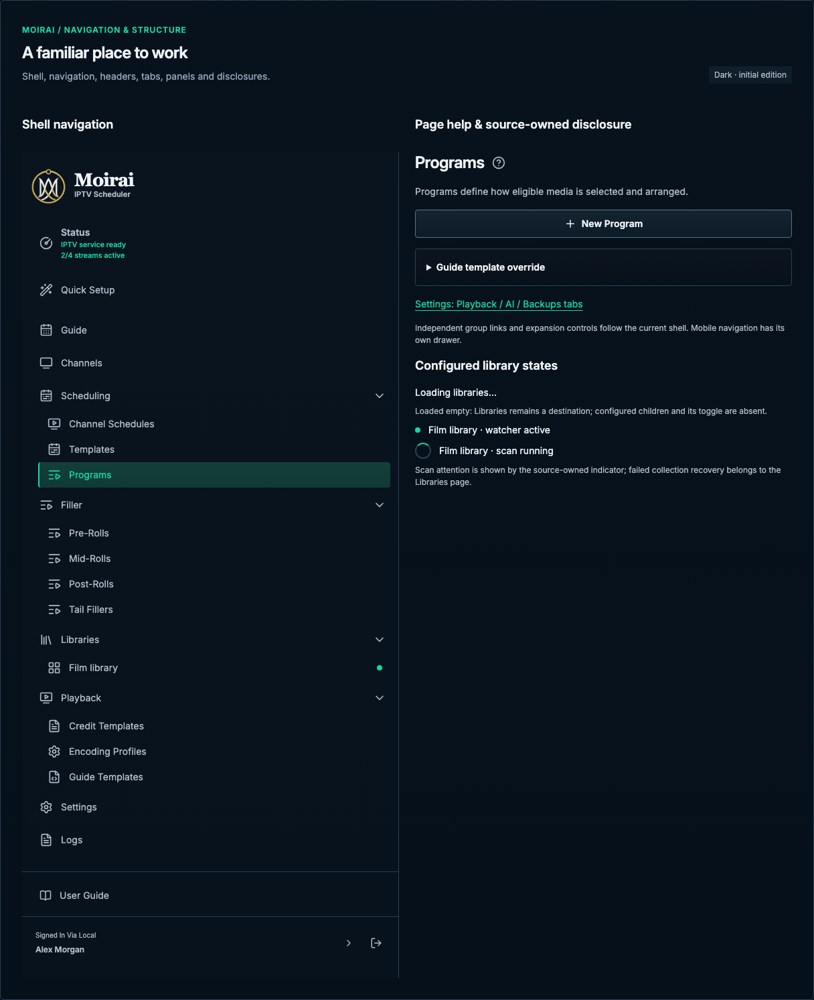

# Navigation & structure

[Handbook](../README.md) · [Live specimen](../index.html?family=navigation) · [Full layout](../images/layouts/catalog.png)

## Current UI baseline

Preserve the 244px desktop rail, current wordmark and “IPTV Scheduler” tagline, grouped Libraries / Scheduling / Filler / Playback navigation, resource names, and service readiness. Mobile replaces the rail with navigation access rather than inventing different destinations.

Source owners: [App.vue](../../../apps/web/src/App.vue), [PageHeader.vue](../../../apps/web/src/components/PageHeader.vue), [ResourceEditorHeader.vue](../../../apps/web/src/components/ResourceEditorHeader.vue).

Apply [the current-UI mapping and reviewed unifications](../docs/current-ui.md) before the component parameters below. Numeric radii describe the baseline; the active half-radius trial remains a separate override.

## Purpose and anatomy

Provide a stable frame for the active resource and its next task. The shell owns global destinations and service readiness. A page owns its title, description and actions; panels own cohesive groups within it. Navigation links change locations; action buttons perform work.

## Parameters and variants

| Component      | Geometry and appearance                                                          | Content rules                                                           |
| -------------- | -------------------------------------------------------------------------------- | ----------------------------------------------------------------------- |
| Desktop rail   | `--sidebar-width` 244px; navigation background; 16px horizontal / 20px top inset | Brand, named destinations, service state at bottom                      |
| Destination    | 44px minimum, 12px inset, 12px icon gap, 8px radius                              | 20px icon plus 14px label; current page has mint edge and selected fill |
| Page header    | 32/40px title, 2px description gap, 24px action gap                              | Main action aligned top right on desktop                                |
| Panel          | 24px inset, 16px internal gap, 12px radius, structural border                    | Use one panel per coherent responsibility                               |
| Section header | 18/26px, 600; 16px before body                                                   | Optional compact action at right                                        |
| Section links  | 24px gap; 12px vertical inset; 2px active underline                              | `aria-current="page"` for the active destination                        |
| Disclosure     | 16px inset; 8px radius; 12px expanded-content gap                                | Native `details` / `summary`, sentence-case task label                  |

Settings section headings may include a plain 24px outline icon. Do not surround heading icons with a decorative bezel, background tile or oversized empty frame. Preserve the existing section composition when standardizing its typography and spacing.

All destination rows and navigation group headings pair their label with a 20px Lucide icon, using the existing Moirai mappings in App.vue. Keep a consistent 12px icon/label gap, inherit the label’s active or muted color, and place group disclosure chevrons at the trailing edge. Icons are decorative; labels and native disclosure semantics remain authoritative. The same sidebar content appears in the mobile help/navigation example.

## Contextual help

Keep the existing question-mark help beside applicable page and editor titles: Programs, Libraries,
Channel Schedules and Channels in the reference layouts, including mobile and protected dialogs.
Use PageHelpButton's accessible `Help with …` label and matching topic; 20px glyph inside a 24px visual
frame with a 44px expanded pointer target. It must not inflate the title/subtitle gap. Settings retains
its existing card-level controls and intentionally hides page-level help.

Help opens a contextual drawer, Escape closes it and focus returns to the opener. Preserve the
Open full guide link. The self-contained gallery copies the existing bundled topic HTML, review states and local artwork. Its footer opens a local chapter snapshot; it does not approve or publish the guide.

## States and behavior

The current destination uses `--color-selected`, a mint edge and `aria-current`; hover uses `--color-hover`, press uses the selected surface, and keyboard focus uses the global ring. Apply the hover fill and brighter text/icon color to destination rows and disclosure headings; retain the mint selected fill and edge when the current destination is hovered. Decorative destination examples receive the same hover appearance. [Layout hover example](../images/layouts/catalog-navigation-hover.png). Do not make the entire rail mint. A collapsed disclosure shows its title and indicator; expanded content stays in reading order. Native summary supports Enter and Space. Section links navigate between locations. The Settings layout demonstrates actual in-place tabs.

For an actual in-place tab interface, use a tablist with one tab stop, arrow-key movement, Home/End, associated tabpanels and retained focus. Choose automatic activation only when panel switching is immediate. Never add tab roles to ordinary page links.

## Settings tabs and progressive disclosure

Use tabs for substantial settings areas: **Playback**, **AI**, and **Backups**. Use disclosures within each area for secondary controls, previews, diagnostics, and longer explanations. Playback capacity, Filler, and Viewing preferences use distinct content groups with one shared tab footer. Settings card headers retain a plain 24px Lucide icon beside their title and optional subtitle, preserving the requested bezel-free treatment. The AI card uses this header without an eyebrow. Automatic Backup keeps its title, subtitle, independent enable switch, and saved schedule summary visible; its single disclosure reveals policy fields and schedule/storage details together. Keep the switch outside the disclosure button. Do not hide the primary task behind another navigation layer. Collapsed disclosures expose saved values and mark pending drafts separately; loading and failed summaries must not imply a saved value exists.

Tabs use a mint underline for selection, the global ring for keyboard focus, a labeled mint dot for unsaved changes, and a labeled amber attention indicator for errors or warnings. Keep these indicators visible even when their panel is inactive. Keep failure messages persistent in the owning panel and outside closed disclosures.

Maintain one tab stop, wrap Left/Right movement, support Home/End, and connect each tab to its labeled panel. Switching is immediate and keeps focus on the selected tab. Keep panels mounted so drafts survive tab switches without confirmation; leaving the page and restoring configuration still protect all drafts. Each tab has one persistent footer outside its content surface: pending state at the left and Reset then Save at the right. Save applies every pending setting in that tab; Reset uses two-step confirmation and restores that tab’s latest saved baseline. Other tabs retain their drafts. Disable Save for unchanged or invalid drafts and disable both actions during conflicting work. Keep immediate operations such as creating a backup or disabling AI within their sections.

At narrow widths keep a single horizontally scrollable tab row, preserve complete labels, and scroll a keyboard-selected tab into view. Stack field groups and wrap section actions. Use existing disclosure motion, with one committed layout and transform-based movement of affected sections; reduced motion must be effectively immediate.

## Responsive and edge behavior

At ≤900px replace the persistent rail with a 44px menu trigger and an accessible modal navigation drawer. At ≤600px stack page actions below headings and use 16px page insets. The title and description wrap; a long destination label wraps rather than hiding its accessible name. At ≤1220px move inspector access into the main task flow instead of narrowing the catalog indefinitely. The mobile header keeps the brand at left and navigation trigger at right. Its navigation drawer is separate from contextual help, supports Escape/backdrop dismissal and returns focus. Local destinations open represented layouts or source documentation; authentication, sign-out and full application routing remain application-owned.

## Composition

Use [the behavior contract](../docs/behavior.md) for overlay focus and motion. Page padding is 28px vertical and clamp(24px, 2.6vw, 42px) horizontal on desktop, 24px tablet and 16px phone. Keep the 1600px content maximum aligned to the navigation edge. Loading service status must say it is checking; never label it ready before a result exists.

All numeric values are CSS pixels at the default root size unless expressed in rem. Exact token values are indexed in [the token reference](../docs/tokens.md).

Settings has no page-level help button. Put an independent question-mark button after each card heading, including beside a disclosure heading without nesting it inside the disclosure button. It opens only that card’s section in the existing help drawer. Keep **Open full guide** in the drawer footer and link it to the same section on the tab’s dedicated guide page. The guide sidebar groups Playback, AI, and Backups under Settings. Closing help restores focus to its opener and preserves drafts and disclosure state.

## Shell inventory

Use the current order: Status and playback summary; Quick Setup; Guide; Channels; Scheduling
(Channel Schedules, Templates, Programs); Filler (Pre-Rolls, Mid-Rolls, Post-Rolls, Tail Fillers);
Libraries (configured library names and loading/failure/empty variants); Playback (Credit Templates,
Encoding Profiles, Guide Templates); Settings; Logs. Keep User Guide and the account/sign-out footer.
Group heading links and expansion buttons have independent targets and semantics. A library scan
indicator belongs beside its configured library, not an invented global readiness footer.

Status summaries retain their source mint color and .67rem type below the title. Status rows never
shrink within the scrolling navigation. Quick Setup has 8px spacer gaps rather than divider lines.
Keep separate full-sidebar-width rules above User Guide and above the account row; the account text expands and the
chevron/sign-out remain aligned at the right. Status and Logs navigate to separate layouts. The account row keeps a flexible identity column
and independent chevron/sign-out targets.
