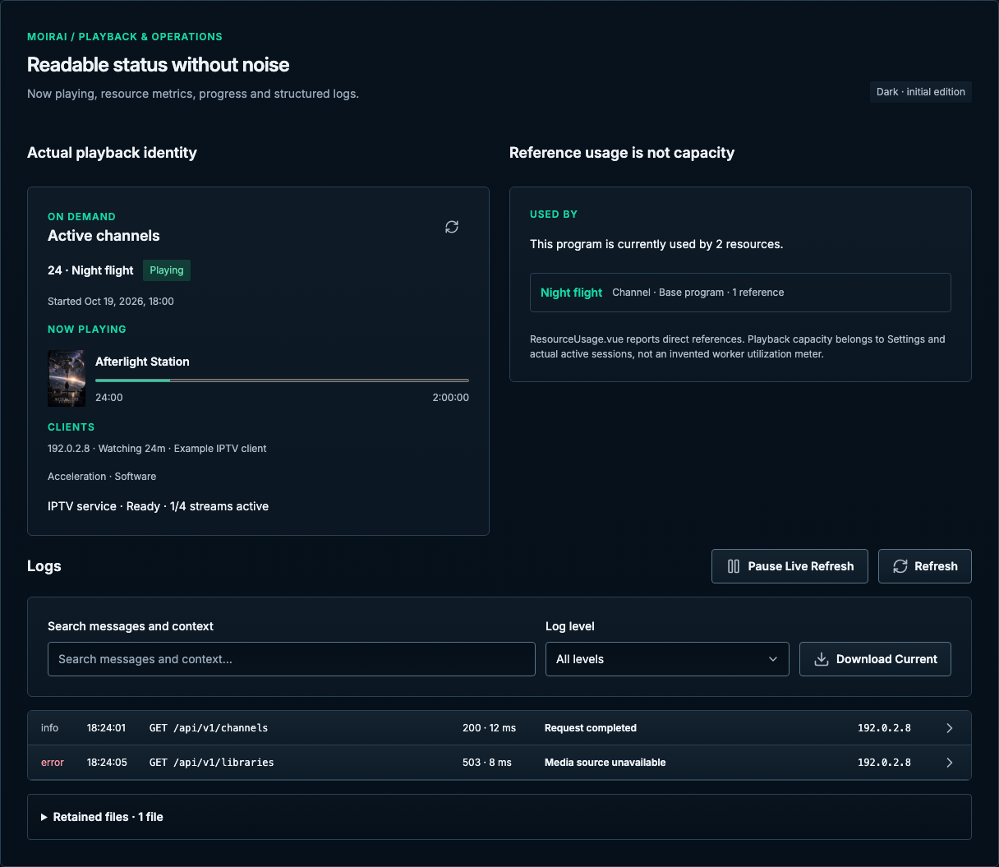

# Playback & operations

[Handbook](../README.md) · [Live specimen](../index.html?family=operations) · [Status layout](../images/layouts/status.png) · [Logs layout](../images/layouts/logs.png)

## Current UI baseline

Keep real service readiness, channel/item identity, capacity and log severity separate. Preparation is not confirmed playable output. Logs and resource panels remain supporting operational surfaces rather than decorative dashboards.

Source owners: [PlaybackNowPlaying.vue](../../../apps/web/src/components/PlaybackNowPlaying.vue), [DashboardPage.vue](../../../apps/web/src/views/DashboardPage.vue), [LogsPage.vue](../../../apps/web/src/views/LogsPage.vue).

Apply [the current-UI mapping and reviewed unifications](../docs/current-ui.md) before the component parameters below. Radii use the permanent 2 / 4 / 6 / 8px scale for small / control / panel / dialog corners.

## Purpose and anatomy

Show real delivery state and resource pressure without implying that preparatory work equals playback. A now-playing section identifies channel, item, time window and progress. Operational panels expose capacity and readiness. Logs preserve severity, timestamp, endpoint, response/duration, message, source, request identity and expandable details.

## Parameters and variants

| Element           | Standard                                        | Content                                            |
| ----------------- | ----------------------------------------------- | -------------------------------------------------- |
| Now-playing panel | 24px inset, 16px gap, 6px radius                | Channel, on-air state, title, timing and progress  |
| Resource metric   | 24/32px 600, tabular figures                    | Current / maximum and explicit unit                |
| Progress          | 8px visual track, 12/18px supporting text       | Elapsed / remaining or completed / total           |
| Readiness badge   | Shared success / warning / danger geometry      | Checking, Ready, Degraded or Unavailable with text |
| Log row           | 12px inset, 12px gap, structural bottom divider | 80px timestamp, 64px level, flexible message       |
| Log type          | 12/18px system monospace                        | Wrap long messages; preserve readable identifiers  |

## States and behavior

Initial readiness is Checking, never Ready by default. On-air status means playable output is confirmed by the authoritative service. A running preparation task is Preparing, not On air. Keep source unavailability, worker capacity and delivery failure distinct. Metrics show known values with units; unknown is not zero. Resource warnings remain visible until resolved or deliberately dismissed.

Use determinate progress only when the denominator is known. For variable work, show phase and progress without a fabricated completion time. Logs use severity text in addition to color and preserve chronological context. Filtering and pausing log updates must be explicit; do not pull the user’s scroll position back to the newest entry while they inspect older records. Never include credentials or sensitive values in examples or messages.

## Responsiveness and accessibility

Do not animate every metric change or pulse an on-air dot. Use polite, bounded announcements for meaningful transitions, not a live-region flood on every log line. On mobile stack capacity panels and wrap log messages; keep timestamps and severity associated with their message. When a wide log view is necessary, contain its scroll and provide selectable text and detail access. Native progress provides accessible numeric state.

The reference uses static fictional status values and local time labels. Real contention, queueing, scans, scheduling and FFmpeg delivery remain application behavior; the design must respect live playback priority rather than introducing heavy rendering to a status screen. See [feedback](feedback.md) for state transitions and [shared behavior](../docs/behavior.md) for motion and failure persistence.

All numeric values are CSS pixels at the default root size unless expressed in rem. Exact token values are indexed in [the token reference](../docs/tokens.md).

ResourceUsage.vue belongs to metadata and editors: it reports direct references and source selection
relationships. It does not report CPU, memory or worker utilization. The operations specimen uses
DashboardPage/PlaybackNowPlaying and Settings playback capacity; there is no invented Worker
capacity percentage or claim that a scan paused automatically.

Logs retains Pause/Resume Live Refresh, Refresh, search, Log level, Download Current, structured
entry buttons, detail modal, Load Older Entries when a cursor exists, scan-limit warning and Retained
files. The local example has two rows and no older cursor; it exercises filtering and detail focus
without claiming a live log connection. Sample network identifiers use documentation-only addresses.

Status and Logs are separate product pages. Their shared component-family board is only a specimen index. Settings Engine details uses a floating tooltip-style display with Escape/outside dismissal and no card reflow.

Saved-backup rows use a bezel-free 18px trash icon in a 42px desktop / 44px touch target, with danger color, subtle hover/pressed feedback and visible keyboard focus. The accessible label and tooltip identify the backup. Use the same control for unreadable archives; activation opens the existing permanent-deletion confirmation dialog rather than a two-step action. Source owner: [BackupSettingsPanel.vue](../../../apps/web/src/components/BackupSettingsPanel.vue). See the [Backups layout](../images/layouts/settings-backups.png).
