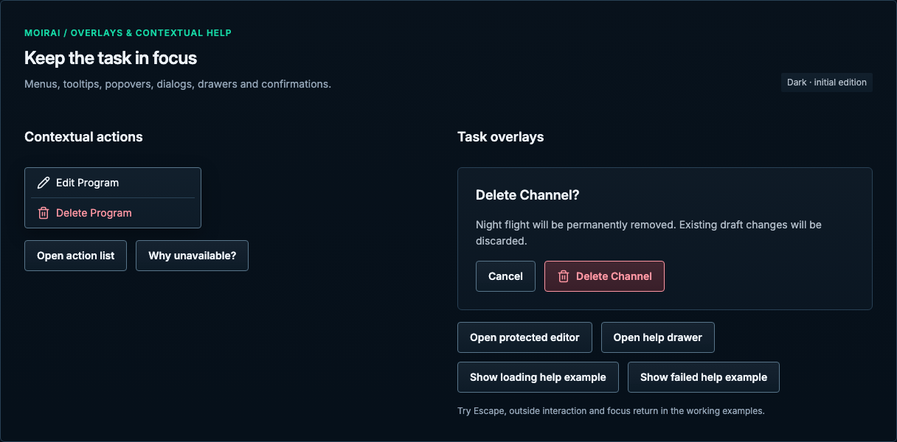

# Overlays & contextual help

[Handbook](../README.md) · [Live specimen](../index.html?family=overlays) · [Full layout](../images/layouts/editor.png)

## Current UI baseline

ActionMenu provides one contextual action surface; native-style rows share that surface. HelpDrawer, confirmation and protected editors have distinct purposes. Existing focus and dismissal ownership must survive visual consolidation.

Source owners: [ActionMenu.vue](../../../apps/web/src/components/ActionMenu.vue), [ConfirmationModal.vue](../../../apps/web/src/components/ConfirmationModal.vue), [HelpDrawer.vue](../../../apps/web/src/components/HelpDrawer.vue).

Apply [the current-UI mapping and reviewed unifications](../docs/current-ui.md) before the component parameters below. Numeric radii describe the baseline; the active half-radius trial remains a separate override.

## Purpose and anatomy

Use a tooltip for a brief explanation, a popover for anchored contextual content, a drawer for an extended supporting task, and a dialog for a focused decision or resource editor. Each overlay has a clear owner and dismissal path; avoid nested modal tasks except a necessary draft or deletion confirmation.

## Parameters and variants

| Component             | Standard                                                | Content                                                                                                                 |
| --------------------- | ------------------------------------------------------- | ----------------------------------------------------------------------------------------------------------------------- |
| Tooltip               | 12/18px, 8px vertical / 12px horizontal, 8px radius     | Raised fill, control boundary, popover shadow; 8px anchor gap                                                           |
| Action list / popover | 240px width bounded by viewport; 4px inset, 8px radius  | Adjacent full-width rows, 32px minimum desktop / 44px phone, 4px vertical / 12px horizontal inset; no individual bezels |
| Editor dialog         | 820px max width; 16px radius                            | 24px sections; persistent header and actions                                                                            |
| Confirmation dialog   | 430px max width; 24px inset                             | Resource name, consequence, safe cancel and explicit action                                                             |
| Drawer                | Help: 620px max width; full dynamic viewport height     | Right edge, square viewport attachment, accessible close icon                                                           |
| Backdrop              | `--color-backdrop`                                      | Blocks interaction with the underlying task                                                                             |
| Layers                | Sticky 10, popover 20, backdrop 30, dialog 40, toast 50 | Native top-layer dialogs/popovers take browser precedence                                                               |

## Focus, dismissal and keyboard

Use modal semantics and a labeled title. Move focus inside at presentation, keep it within the modal, and return it to the trigger on dismissal. Native `dialog.showModal()` supplies this containment in the working reference. Confirmation initially focuses the safe “Keep editing” action for unsaved drafts; permanent-delete confirmation uses “Cancel”. Escape cancels the topmost decision. Backdrop and close icon route through the same dirty-draft guard as Escape for an editor.

Tooltips appear for hover and focus, use `aria-describedby`, contain no interactive content and never replace the trigger’s accessible name. Contextual actions here use the native Popover API with Tab navigation, Escape and light dismissal. If a later implementation chooses ARIA menu roles, it must also implement menu arrow-key and focus behavior. Keep anchored overlays within the viewport; avoid offscreen placement and clipping. The working popover is fixed-position and bounded at the viewport edge.

## Contextual action menus

Use one raised floating surface with adjacent left-aligned action rows. Each row has a 4px corner
radius, 14/20px regular text and no visible resting border or fill. Use an 18px leading icon on every action row
consistently; do not add icons to only some rows without a reserved icon column. Separate destructive
actions with a 1px structural divider and 4px margins. Destructive text is danger-colored, with a
danger surface only on hover or keyboard focus. Other rows use the hover surface for feedback.

Use native buttons and links in normal Tab order. The trigger exposes `aria-expanded` and
`aria-controls`. Opening focuses the first action; Escape and action activation return focus to the
trigger. Outside interaction dismisses without taking focus away from the newly chosen target.
Do not add ARIA menu roles without also supplying their arrow-key navigation contract. The static
specimen and live popup use identical menu-row markup and styling.

## Confirmation policy and adaptation

Top-level persisted deletion always requires the styled modal. State the resource name and consequence; unsaved changes do not block access to Delete. Nested draft-local removals use the [two-step action](actions.md). Draft protection is described in [editors](editor.md).

Use 16px minimum viewport gutters, including safe-area insets in production. Mobile editors may use 8px gutters as shown in the reference full-height composition, with internal controls 44px tall. The body scrolls inside a bounded overlay; the header and footer remain visible. Do not animate surrounding heavy layout continuously; follow [motion rules](../docs/behavior.md).

All numeric values are CSS pixels at the default root size unless expressed in rem. Exact token values are indexed in [the token reference](../docs/tokens.md).

## Open-state examples

- [Tooltip with keyboard focus](../images/specimens/tooltip-open.png)
- [Contextual action popover](../images/specimens/popover-open.png)
- [Help and navigation drawer](../images/specimens/drawer-open.png)
- [Dirty-draft discard confirmation](../images/specimens/discard-confirmation.png)
- [Permanent deletion confirmation](../images/specimens/delete-confirmation.png)

## Narrow reference captures

[390px specimen](../images/specimens/overlays-390.png) · [320px specimen](../images/specimens/overlays-320.png)

Every contextual action row has an 18px leading Lucide icon in a consistent column: Pencil for Edit,
Copy for Duplicate and Trash2 for Delete. Glyphs inherit the row color; retain labels, the destructive
separator, native button semantics and existing dismissal/focus behavior.

Contextual help preserves the source header (book icon and guide version), scrollable topic title,
description, actual topic HTML, review warning where present and persistent Open full guide footer.
Loading, failed/retry and loaded topic states stay distinct. The navigation drawer is a different
surface at the left; Program inspection uses its own right-side drawer below the inline breakpoint.
The local chapter snapshot preserves the source review status and copied assets; it never approves
or publishes the guide. See [the audit boundary](../docs/audit.md#help-content-boundary).
