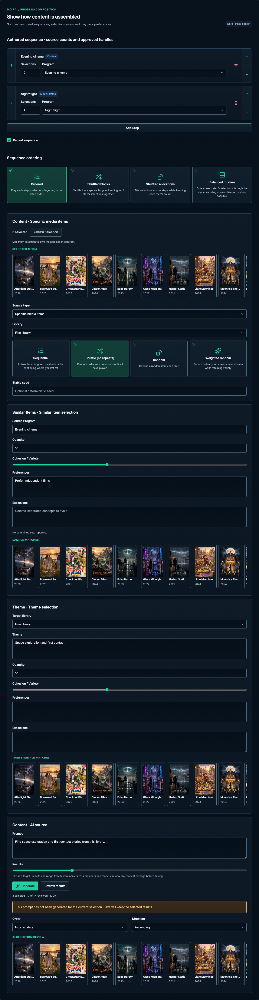

# Program composition

[Handbook](../README.md) · [Live specimen](../index.html?family=programs) · [Full layout](../images/layouts/catalog.png)

## Current UI baseline

Preserve Content, Similar Items, Theme and Sequence terminology and each type’s existing source/ordering sections. Authored sequence order is meaningful. Program inspectors and editors are distinct surfaces, not a newly invented combined workflow.

Source owners: [ProgramEditor.vue](../../../apps/web/src/components/programs/ProgramEditor.vue), [SequenceProgramEditor.vue](../../../apps/web/src/components/programs/SequenceProgramEditor.vue).

Apply [the current-UI mapping and reviewed unifications](../docs/current-ui.md) before the component parameters below. Numeric radii describe the baseline; the active half-radius trial remains a separate override.

Prefer [detailed choice cards](choices.md#detailed-choices-for-significant-decisions) for significant selection and ordering decisions. Preserve the existing strategy descriptions and distinguish Content selection from Sequence ordering.

## Purpose and anatomy

Show how eligible content becomes a program. Distinguish a source definition, an authored sequence, a selected media set and playback preferences. A definition describes rules; a preview illustrates their current result; neither should be confused with a persisted playback schedule.

## Parameters and variants

| Component         | Standard                                                                                                    | Content and ownership                                                       |
| ----------------- | ----------------------------------------------------------------------------------------------------------- | --------------------------------------------------------------------------- |
| Source card       | 24px inset, 12px radius, structural border                                                                  | Source name with adjacent type badge, summary, explicit edit/remove actions |
| Sequence row      | Ordered list, 16px gaps, 40px leading number handle, 45px right arrow handle; body inset 24px / 16px mobile | Author order is meaningful; visible order controls                          |
| Type badge        | Shared badge geometry                                                                                       | Content / Sequence / Similar labels with semantic category tones            |
| Selection review  | Panel with 16px gap                                                                                         | Count, total duration, selected items and Review Selection action           |
| Preferences group | Shared form geometry; 24px section gap                                                                      | Playback order, repeat handling and source-specific choices                 |
| Preview summary   | 12/18px metadata                                                                                            | State whether generated, estimated or current; avoid false certainty        |

## States and behavior

Sources can be loading, loaded, unavailable or invalid. Preserve a missing source’s identity and show a repair action instead of quietly dropping it. A preview has separate loading and failed states; it must not imply an empty program before the lookup finishes. A disabled source row can still provide inspection and explanation.

Authored sequence order is stable and deliberate. Place the ordinal in an integrated 40px-wide leading handle with a raised fill, mint tabular number and 1px right divider. The handle follows the card’s left corners; the whole card and Add source button share the same left and right edges. Reset the ordered list’s external marker gutter while retaining list semantics. This handle presents the step number, not a draggable affordance; do not add a grab cursor or drag-only interaction. Provide Move up / Move down as a vertically stacked pair of 18px Lucide arrow buttons in an integrated 45px-wide right handle (including its 1px left divider, leaving 44px-wide targets). Each half has at least a 44px interaction height, with equal height, a shared raised surface and a 1px separator. Keep the first step’s Up and the last step’s Down disabled. Give each button an explicit accessible name including the source and direction; native buttons support Enter/Space. Inset the focus outline by 4px to keep it inside the handle. Do not put separate text movement buttons in the content body. If drag handles are added later, provide equivalent keyboard operation and announce the resulting position. Draft-local removal sits vertically centered within the complete step, immediately before the right ordering handle. It uses an initially bezel-free 18px trash icon in a 42px desktop / 44px mobile target, with an accessible name that identifies the source. It changes to the 17px confirmation checkmark with a subtle danger-tinted bezel and no geometry change, and follows the two-step confirmation contract and can be undone by discarding the editor. Stable source identifiers must not share ownership accidentally; duplicate identifiers are a data-boundary validation concern, not a visual normalization rule.

Selection review shows the exact set or explicitly labeled scope before adding it. Review Selection opens the selected set; it does not save the Program. Keep generation/AI progress, cancellation and errors in context if used; do not show a successful count before the result is known. Generated suggestions must still use ordinary media cards and review patterns.

## Adaptation and composition

On mobile source cards become a single column, long names wrap, and ordering controls remain reachable at 44px targets. Use metadata for duration and source count without making every fact a badge. Reuse the same preference fields across program types, exposing differences only when they change the user’s decision. Do not animate sequence rearrangement with per-frame layout measurements; a bounded FLIP transition is preferred if motion is useful.

The board illustrates source and review composition; source querying, preview generation, ordering mutation and media persistence remain application responsibilities. The draft-local two-step action is live. See [resource editors](editor.md), [media](media.md), and [shared behavior](../docs/behavior.md).

All numeric values are CSS pixels at the default root size unless expressed in rem. Exact token values are indexed in [the token reference](../docs/tokens.md).

[Narrow 390px specimen](../images/specimens/programs-390.png) · [320px specimen](../images/specimens/programs-320.png)

## Source-owned fields and conditions

| Owner                                       | Fields and dependencies                                                                                                                                                                                                      |
| ------------------------------------------- | ---------------------------------------------------------------------------------------------------------------------------------------------------------------------------------------------------------------------------- |
| ProgramEditor / ProgramTypeRail             | Name required; fixed type for existing rules; Content / Similar Items / Theme / Sequence for new rules; persistent resource actions and Used by                                                                              |
| Content source                              | Existing source type and library are fixed when editing; Library query, Specific media items, Specific media groups and configured AI are current create choices; legacy item/group values remain compatible                 |
| SelectionStrategyEditor                     | Sequential / Shuffle (no repeats) / Random / Weighted random; optional Stable seed for non-sequential choices; playback order only for Sequential                                                                            |
| ProgramSourceBrowser / MediaSelectionDrawer | Browse media, search, hierarchy, per-item/group Add/Remove, Review Selection, missing-indexed-item warnings and preserved draft references                                                                                   |
| SequenceProgramEditor                       | Count 1–10000 and referenced Program for each step; Add Step; Repeat sequence; first/last movement boundaries; draft-local removal                                                                                           |
| SequenceOrderingEditor                      | Ordered / Shuffled blocks / Shuffled allocations / Balanced rotation; Stable seed only for shuffled modes; children retain their own selection/playback rules                                                                |
| SimilarityProgramEditor                     | Similar Items source is a Specific Items or AI Program; Theme uses Target library and Theme text; both own Quantity, Cohesion / Variety, Preferences, comma-separated Exclusions and conditional Exclusion strictness slider |
| ProgramAiSource                             | Prompt, Results target, Generate/Reconnect, progress/coverage, persistent failures and partial/stale-result warnings, Review results, and order/direction for Sequential; no automatic Save                                  |
| ProgramPlaybackPreferences                  | Optional inherited audio/subtitle rules; specific language/title dependencies, preview channel context and music-video credit template                                                                                       |

The reference implements local counts, ordering, removal, mode-dependent seed visibility and protected
Sequence draft actions. Source querying, source-browser hierarchy, AI generation/reconnection,
media persistence and complete provider validation remain application-owned. [Sequence editor](../images/layouts/program-editor.png).
