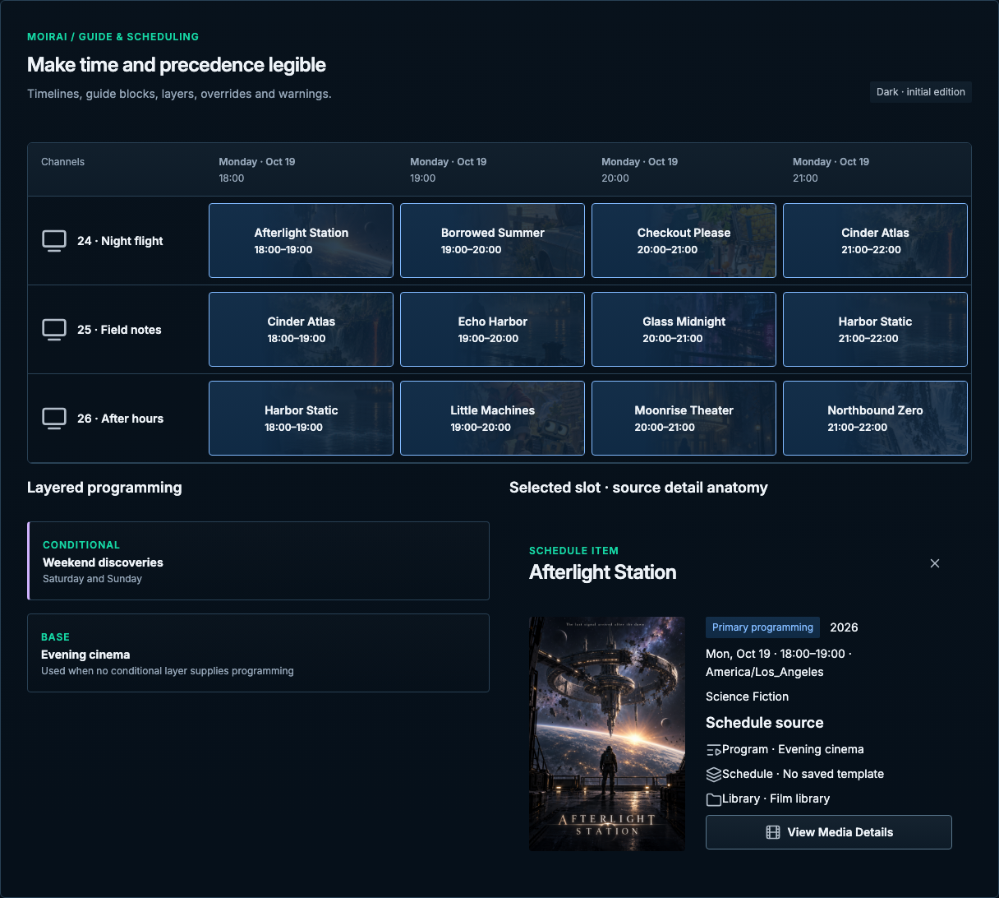

# Guide & scheduling

[Handbook](../README.md) · [Live specimen](../index.html?family=scheduling) · [Full layout](../images/layouts/schedules.png)

## Current UI baseline

Channel Schedules is a channel-owned stack catalog with base / conditional assignments, readiness, Schedule stack and Next 24h summaries, and Edit Schedule access. The Guide timeline is a separate view; do not merge it into this page.

Source owners: [ChannelScheduleCatalog.vue](../../../apps/web/src/components/schedules/ChannelScheduleCatalog.vue), [GuideTimeline.vue](../../../apps/web/src/components/GuideTimeline.vue).

Apply [the current-UI mapping and reviewed unifications](../docs/current-ui.md) before the component parameters below. Radii use the permanent 2 / 4 / 6 / 8px scale for small / control / panel / dialog corners.

## Purpose and anatomy

Make time, channel identity and schedule precedence legible together. A guide consists of a labeled time axis, channel labels, program blocks, selected context and optional now marker. A schedule section explains which layer supplies programming, not merely a stack of colored cards.

## Parameters and variants

| Element           | Standard                                                           | Content                                                             |
| ----------------- | ------------------------------------------------------------------ | ------------------------------------------------------------------- |
| Timeline viewport | 6px radius, structural border; 680px minimum inner width           | Named keyboard-scrollable region on small screens                   |
| Time axis         | 12/18px muted, 12px vertical inset                                 | Time labels align to block boundaries; timezone nearby              |
| Channel column    | 13.53rem channel column in Guide; 108px row minimum                | Number plus channel name                                            |
| Program block     | 8px outer vertical gap, 4px horizontal gap; 12px inset; 4px radius | 14/22px 600 title and 12/18px time                                  |
| Block tones       | Info, purple, selected semantic pairs                              | Category label or layer text accompanies hue                        |
| Schedule layer    | 16px inset, 16px gap, 4px radius, structural border                | Name, applicability, priority and edit action                       |
| Override          | 3px purple leading edge and textual “Override” label               | Explain replacement, not merely active state                        |
| Now marker        | 2px mint line with “Now” time label                                | Only use for actual current time, never animate with fake stability |

## States and interactions

Guide listings expose the source-owned Schedule item modal, with artwork, role/year/duration, airtime, plot/genres when known, Program/Schedule/Library source and View Media Details when indexed. Loading and persistent failures belong inside that modal. The local example uses known fixture identity and source links; it does not fetch segment details. Hover changes the surface without moving time geometry. Blocks are keyboard-operable named controls; selected content must be inspectable without pointer hover. If a block is too short to fit a title, show its full accessible name and expose details through focus or activation. Busy or failed guide generation must stay distinct from an empty schedule.

Configured stacks present conditional layers above the base fallback, matching ChannelScheduleCatalog. Explain whether a rule replaces matching base programming. Show conflicts, gaps and unresolved media as contextual warnings with a repair route; do not silently normalize an authored sequence. Timezone, day boundaries and daylight-saving ambiguity must come from the application’s scheduling contract. The fixed reference uses local fictional hour slots, not a scheduling algorithm.

## Responsive and motion behavior

Keep horizontal overflow inside the guide viewport. In production, preserve useful channel/time context during scrolling and maintain alignment with virtualized geometry. Do not animate frequently changing block dimensions or remeasure sticky offsets per frame. On phone preserve the existing scrollable channel/time window. No invented alternate agenda or drag editor is introduced.

No drag-and-drop interaction is implemented here. Any adopted timeline editor must provide keyboard-accessible move/resize actions and explicit time feedback. See [program composition](programs.md) and [shared behavior](../docs/behavior.md).

All numeric values are CSS pixels at the default root size unless expressed in rem. Exact token values are indexed in [the token reference](../docs/tokens.md).

## Channel schedule editor contract

The catalog links to the channel-owned editor. Keep its source-owned Base assignment, conditional
layers, predicates, template/program choices, resolved preview and persistent draft actions. An empty
stack offers Add Program / Add Template / Create Program according to existing prerequisites.
Next 24h distinguishes known preview, dead air, pending and failed summaries. Do not merge the
committed Guide into this editor. The [fresh mobile editor evidence](../images/source-audit/mobile-schedule-editor.png)
shows the existing surface; the reference catalog preserves its entry point without recreating the
scheduling engine.

## Guide data boundary

The [Guide layout](../images/layouts/guide.png) retains the compact IPTV feed bar, M3U/XMLTV copy buttons, week
navigation, Today, timezone and channel listings. The example feed hostname is reserved fictitious
content; copy actions use only the local example URLs. The four-hour visual window
is static sample content. A Sequence guide preview is a separate single sample-day track with
step colors and progress context; it is not a multi-channel Guide.

[Guide detail example](../images/layouts/guide-detail-open.png) · Escape and the close button restore listing focus.

Guide cards keep the artwork background: cover/right alignment, brightness .45, opacity .32, and a
left-to-right transparent-to-opaque mask (28%–70%). Listing text stays above it with AA contrast.
The compact feed bar is an explicit revision; it replaces the exposed URL input/Open rows.
