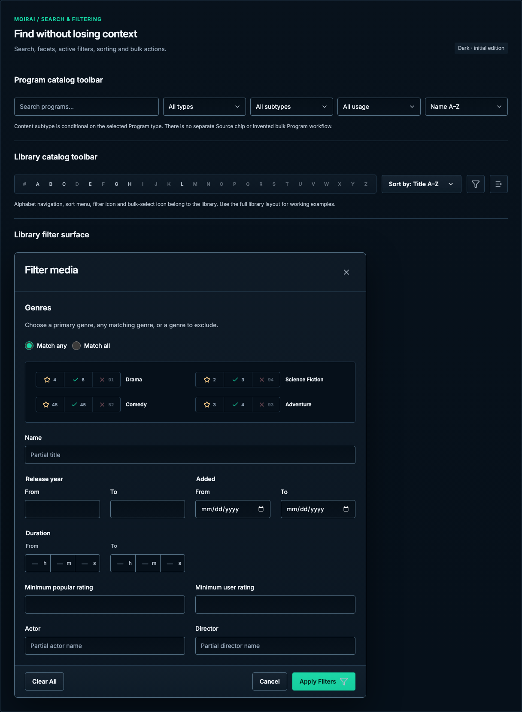

# Search & filtering

[Handbook](../README.md) · [Live specimen](../index.html?family=search) · [Full layout](../images/layouts/catalog.png)

## Current UI baseline

Programs uses search, type, Content definition, usage and ordering controls. Library search, scan status, browse filters and sort belong to a specific configured library. Do not replace these with a generic global catalog workflow.

Source owners: [ProgramCatalogToolbar.vue](../../../apps/web/src/components/programs/ProgramCatalogToolbar.vue), [LibraryPage.vue](../../../apps/web/src/views/LibraryPage.vue).

Apply [the current-UI mapping and reviewed unifications](../docs/current-ui.md) before the component parameters below. Numeric radii describe the baseline; the active half-radius trial remains a separate override.

## Purpose and anatomy

A collection toolbar combines a labeled search field, a bounded set of facets, sort order, view controls and optional creation action. An active-filter summary explains why results differ from the full catalog. A selection bar explains what a bulk operation will affect.

## Parameters and variants

| Element        | Standard                                           | Composition                                                                                                                                      |
| -------------- | -------------------------------------------------- | ------------------------------------------------------------------------------------------------------------------------------------------------ |
| Toolbar        | 12px gaps; controls 42px minimum                   | Search grows twice as much as facets; fields at least 130px wide before wrapping                                                                 |
| Search         | Shared field geometry                              | Search icon 20px if used; clear action named explicitly                                                                                          |
| Facet select   | Shared select geometry                             | “All types” is a value, not a placeholder; all select carets are 16px, inset 12px from the right, with 40px text-end padding across every layout |
| Filter chip    | 12/18px, 4px vertical / 8px horizontal, 4px radius | Named remove control; preserve complete filter meaning                                                                                           |
| Result summary | 12/18px muted                                      | Announce only after successful load; retain loading and error distinction                                                                        |
| Selection bar  | 16px inset, 12px gaps, 8px radius                  | Count, scope, available action, clear selection                                                                                                  |

## Genre rule bar

The library filter follows `LibraryFilterModal.vue` and `_library-filter.scss`: a leading 198px-wide bar with three equal segments, followed by the genre name. Each segment pairs a 16px icon with a tabular count (0.64rem). Counts in the reference are fictional library totals, not live query results. Long genre names truncate visually but retain their full title and accessible control labels.

The star uses `--color-warning` (gold), the check uses `--color-accent` (mint), and the exclusion cross uses `--color-danger` (red). Resting counts use `--color-muted`. Selected primary/include segments use a muted green fill (#146852); exclusions use a muted red fill (#80303d), with `--color-text` counts. The gold star remains gold when selected. The bar has a shared border and adjoining segments, with no internal gaps or individual rounded buttons. Its radius follows `--radius-control`, including the active half-radius trial. Controls are 34px high on desktop and 44px at ≤680px; the genre grid becomes one column at that breakpoint.

Selection remains optional and mutually exclusive within each genre. Activating the selected segment clears its rule. Match any disables and clears exclusions; Match all enables them. The full library demo exercises these states; the specimen illustrates their geometry. Keep loading, unavailable counts and rule-limit feedback in the application; this local fixture does not simulate contextual count requests.

## Field grouping

Preserve the source filter rows: Release year beside Added, Duration on its own row, both minimum ratings together on the next row, then Actor beside Director. Keep the rating pair and people pair as separate two-column groups; at narrow widths they stack in reading order. Do not let the odd number of range fields shift the rating or people fields into unrelated rows.

## Duration range

Preserve [DurationFilterInput.vue](../../../apps/web/src/components/library/DurationFilterInput.vue): separate From and To bounds, each with three equal adjoining Hours, Minutes and Seconds inputs inside one shared border. Use text inputs with numeric input mode, an em-dash placeholder, accessible unit labels and visible h/m/s suffixes. Desktop segments are 40px tall with 10px/22px/10px/10px padding; mobile segments are 44px tall. Use `--color-control` for borders, `--color-secondary` for suffixes, `--color-accent` for focus-within, and `--radius-control` including the active radius trial.

Blank bounds mean unrestricted. The application accepts whole nonnegative hours and minutes/seconds from 0–59, preserves second precision, and requires To ≥ From; failures remain inline and block Apply. The standalone reference demonstrates entry and focus, without duration validation or query submission.

## States and behavior

Search has default, focused, populated and cleared states. Entering text should preserve keyboard focus. If results load asynchronously, announce a concise settled result with a polite live region rather than every keystroke. A zero-result search says “No matching programs” and offers Clear filters; a truly empty resource catalog offers creation. A failed lookup preserves the filters and shows Retry. Never render “0 programs” during first load.

Facet selection and sort choices remain visible. Active filter removal updates its accessible label with the filter name. Filtering and selection are separate: show whether selection is limited to visible results, retained across pages, or explicitly cleared. Bulk actions must operate on the scope communicated by the bar; do not silently broaden to all records.

## Accessibility and responsive behavior

Use labeled native controls. Clear and remove buttons support keyboard activation. At ≤900px wrap facets beneath search; at ≤600px keep search full width and expose secondary filters in a labeled drawer or stacked group. The mobile layout shows the drawer entry point visually; filtering itself is not wired. Keep selected counts in the task flow when space is limited. Long query values scroll within the input; chips wrap and their accessible names remain complete.

## Demonstration boundary

The gallery toolbar illustrates composition and native input state. It does not implement backend queries, debounce, result fetching, filter persistence or bulk mutation. Its count is a fixed fictional fixture. The state boards and [shared contract](../docs/behavior.md) specify the real asynchronous requirements without implying a working search service.

All numeric values are CSS pixels at the default root size unless expressed in rem. Exact token values are indexed in [the token reference](../docs/tokens.md).
